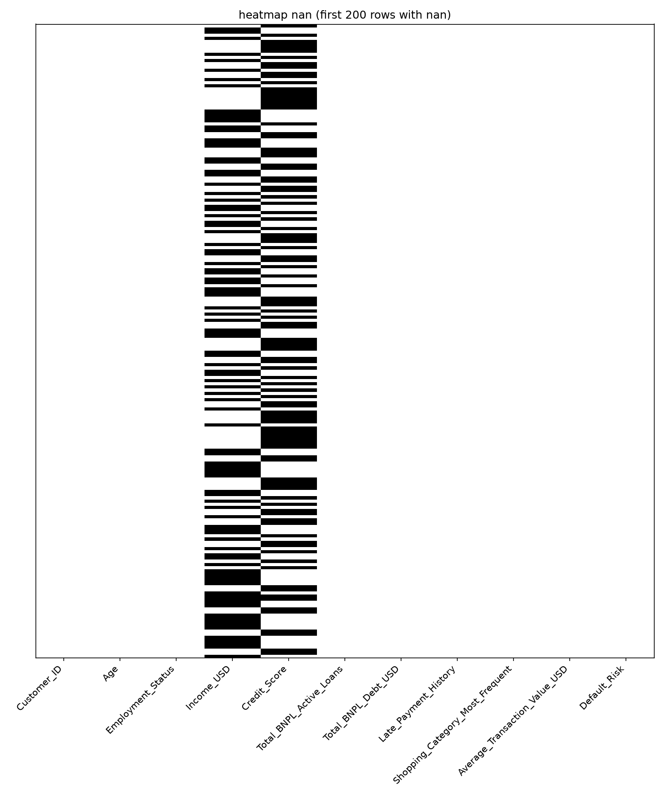
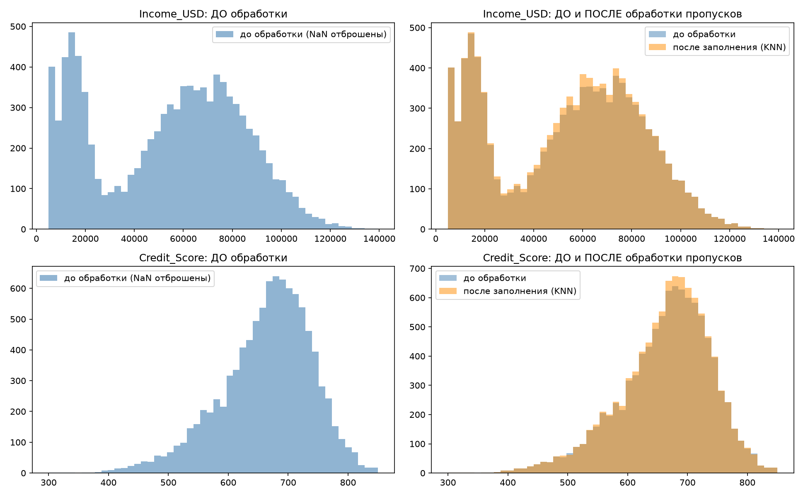
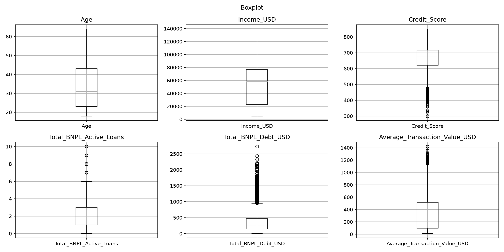

# Лабораторная 2. Предобработка данных

Перед обучением модели нужно разобраться с пропусками, выбросами и строковыми признаками. В работе сравниваются способы обработки на таблице клиентов с покупками в рассрочку.

## Запуск

```powershell
cd D:\BSTU\7sem\IOAD\lab2
python lab2.py
```

Нужны `numpy`, `pandas`, `matplotlib`, `scikit-learn`. Исходный файл — `data.csv`, результат — `data_processed.csv`. Чтобы получить картинки без открытия окон в PowerShell:

```powershell
$env:LAB2_NO_SHOW = '1'
python lab2.py
Remove-Item Env:LAB2_NO_SHOW
```

## Основные части кода

1. `isna().sum()` считает пропуски по столбцам и строкам. В исходном CSV 305 пропусков дохода и 298 пропусков кредитного рейтинга.
2. Создаются четыре копии таблицы: заполнение средним, медианой, медианой по группе и методом `KNNImputer(n_neighbors=5)`.
3. Перед KNN числовые столбцы масштабируются через `MinMaxScaler()`: иначе расстояния в основном зависели бы от дохода, который измеряется десятками тысяч.
4. `inverse_transform()` возвращает заполненные значения в исходные единицы. Для дальнейших шагов выбрана таблица после KNN.
5. Гистограммы сравнивают распределения до и после заполнения. Через boxplot и правило `1.5 * IQR` находятся выбросы. Строка удаляется, если выброс есть хотя бы в одном числовом признаке.
6. `map()` заменяет Yes/No на 1/0 и Low/Medium/High на 0/1/2. `get_dummies()` создаёт отдельные столбцы для категорий занятости и покупок. Идентификатор клиента удаляется.
7. Создаются варианты с `MinMaxScaler` и `StandardScaler`. В `data_processed.csv` записывается **немасштабированная** таблица `df`, а не `df_mm` или `df_std`.

## Картинки







## Ключевые понятия

`IQR = Q3 - Q1` — межквартильный размах. Значения вне `[Q1 - 1.5 * IQR; Q3 + 1.5 * IQR]` рассматриваются как кандидаты в выбросы. Большой долг может быть реальной записью, поэтому в коде отдельно выводится состав таких клиентов.

MinMax переводит значения в диапазон от 0 до 1. StandardScaler вычитает среднее и делит на стандартное отклонение. One-hot нужен для категорий без естественного порядка: кодирование занятости числами 0, 1, 2 создало бы искусственный порядок.

Групповое заполнение `Credit_Score` здесь использует `Default_Risk` только для сравнения способов предобработки. При прогнозировании риска так делать нельзя: ответ заранее неизвестен. В отдельной задаче обучения заполнение и масштабирование нужно рассчитывать по обучающей выборке.
