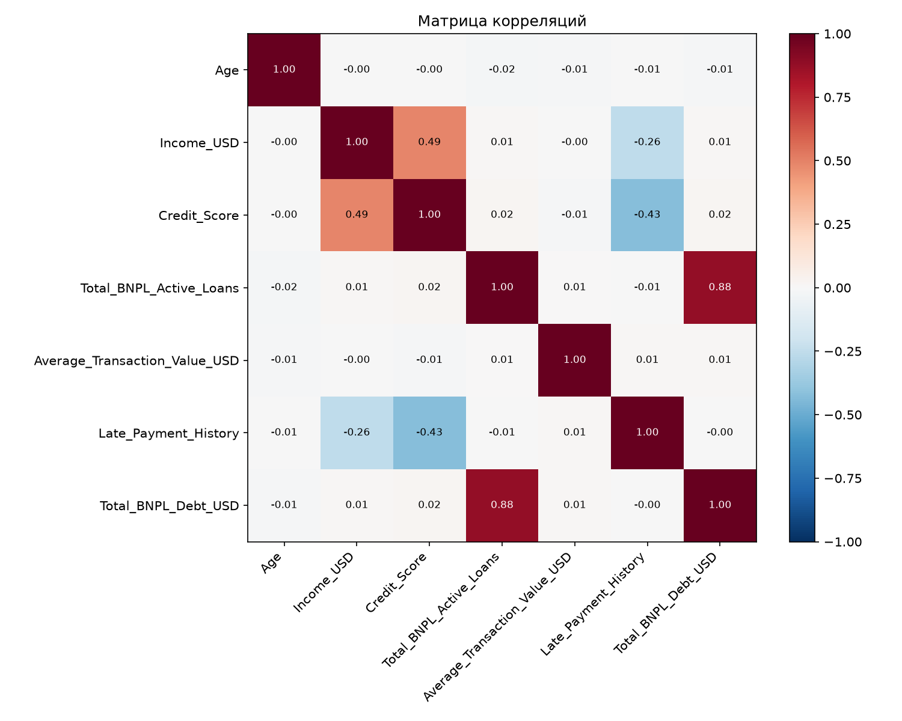
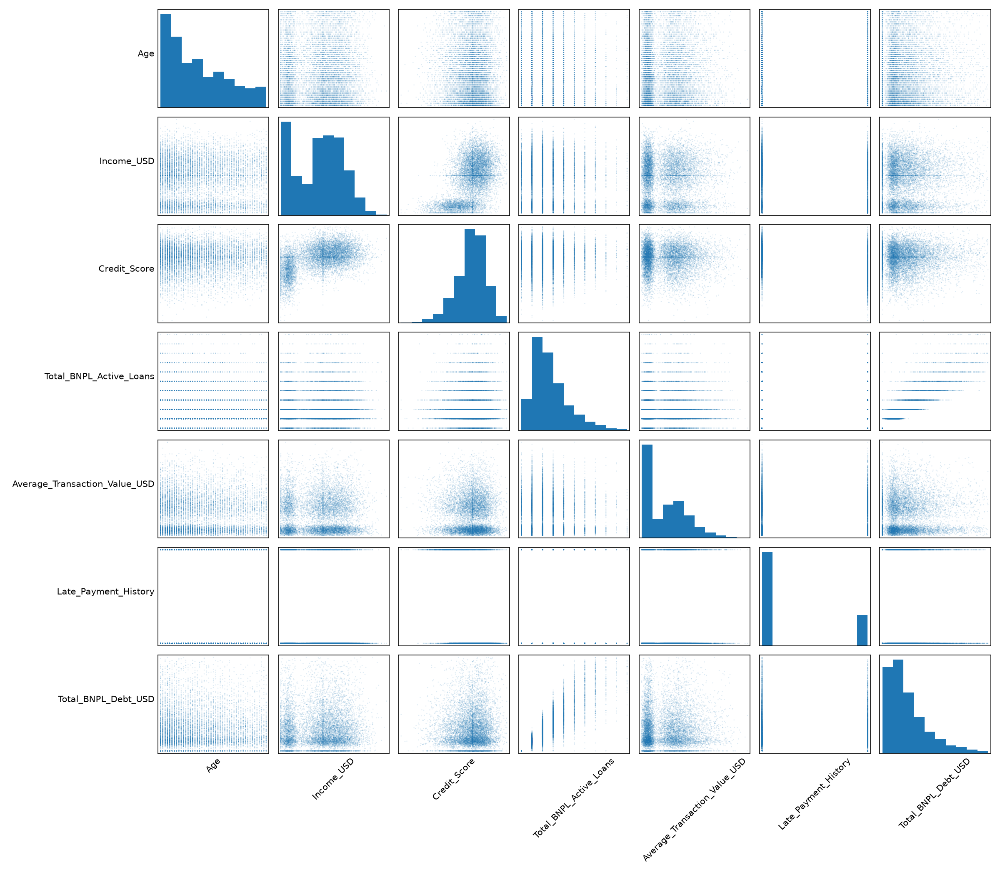
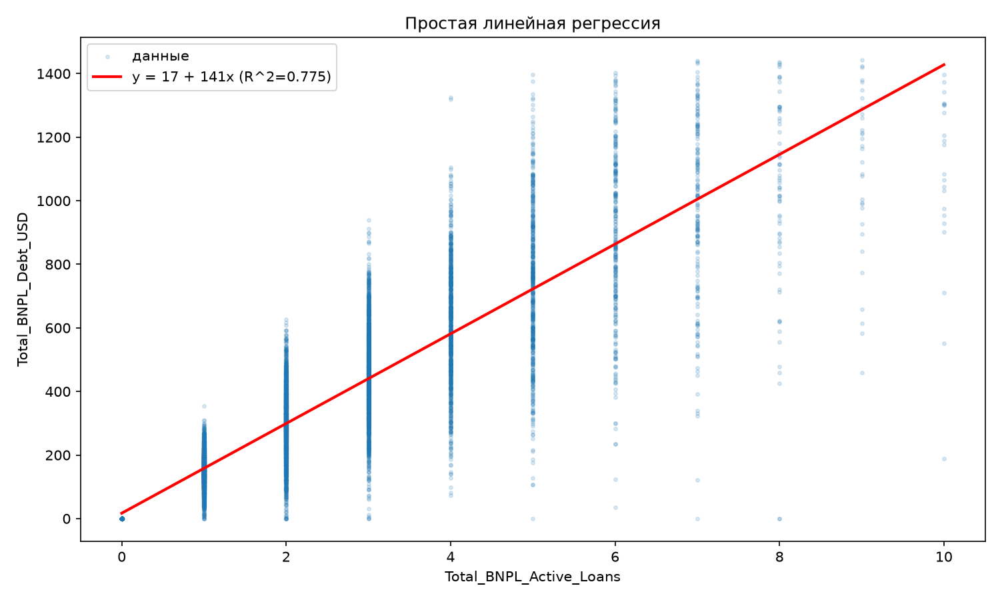
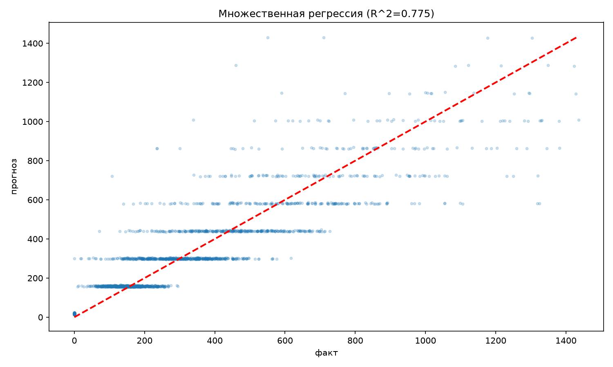

# Лабораторная 3. Линейная регрессия

Задача — предсказать числовую величину `Total_BNPL_Debt_USD`, то есть общую задолженность клиента. Сравниваются регрессия по одному признаку и регрессия по нескольким признакам.

## Запуск

```powershell
cd D:\BSTU\7sem\IOAD\lab3
python lab3.py
```

Нужны `numpy`, `pandas`, `matplotlib`, `scikit-learn` и исходный `data.csv` рядом со скриптом. Переменная окружения `LAB3_NO_SHOW=1` отключает окна, PNG всё равно сохраняются.

## Разбор кода

1. Пропуски дохода и рейтинга заполняются медианами, история просрочек переводится в 0/1. По целевой переменной удаляются значения за границами `3 * IQR`.
2. `corr()` показывает линейные связи между признаками. `scatter_matrix()` помогает посмотреть эти связи на точечных графиках.
3. `cor_t.abs().idxmax()` выбирает признак с самой сильной по модулю корреляцией с долгом. В исходном CSV это `Total_BNPL_Active_Loans`: корреляция примерно 0.886 до обработки.
4. `train_test_split(..., test_size=0.2, random_state=42)` оставляет 80% строк для обучения и 20% для проверки.
5. `LinearRegression().fit(...)` обучает модель. У простой регрессии формула `y = intercept_ + coef_[0] * x`.
6. Вторая модель использует возраст, доход, рейтинг, количество займов, среднюю стоимость покупки и историю просрочек. Каждый коэффициент относится к своему столбцу.
7. `r2_score()` и корень из `mean_squared_error()` сравнивают качество прогнозов.

## Картинки









## Что означают результаты

`R² = 1` соответствует точному прогнозу, `R² = 0` — качеству прогноза средним значением. Отрицательное R² означает, что модель хуже такого среднего прогноза. RMSE измеряется в долларах, как и задолженность: меньше — лучше.

На графике «факт — прогноз» идеальные ответы лежали бы на диагонали. Разброс относительно неё показывает ошибки.

Добавление признаков само по себе не гарантирует улучшения на новых данных. Сравнивать надо прежде всего `R² test` и `RMSE test`. Последняя текстовая фраза в скрипте о том, что остальные признаки не улучшают модель, задана заранее; её следует проверять по реально выведенным числам.

В текущем варианте медианы, границы выбросов и выбор главного признака рассчитываются до разделения данных. Это ограничение данной реализации при оценке качества на новых данных.
