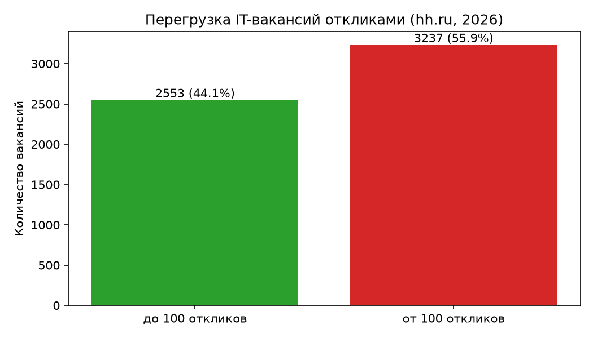
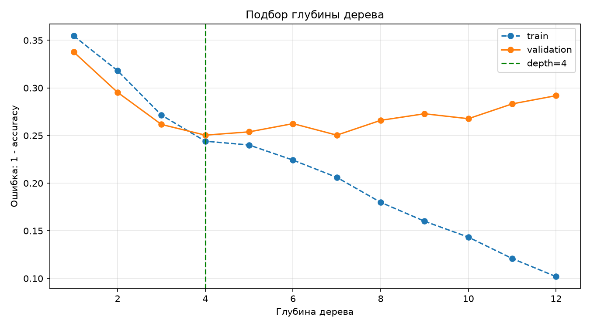
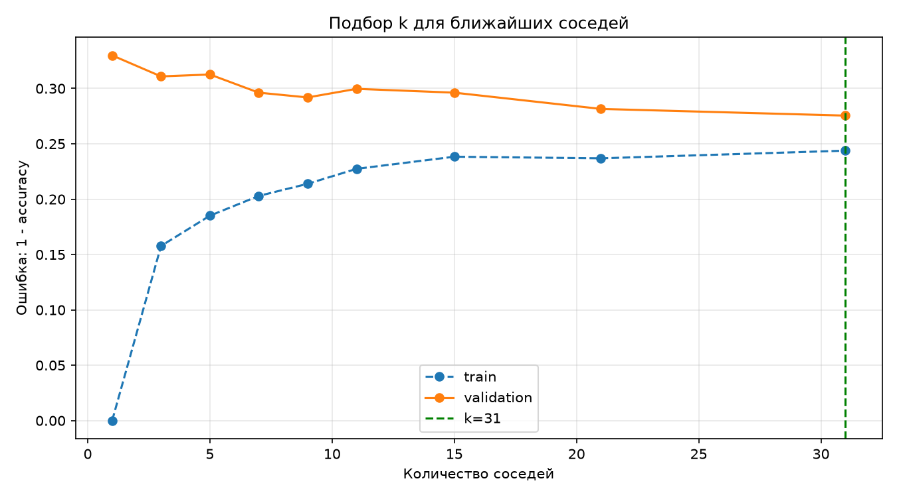
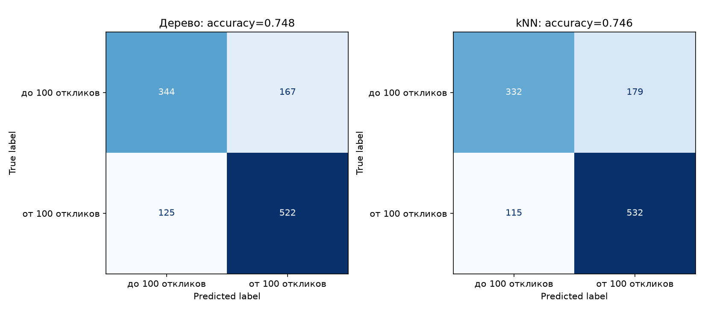
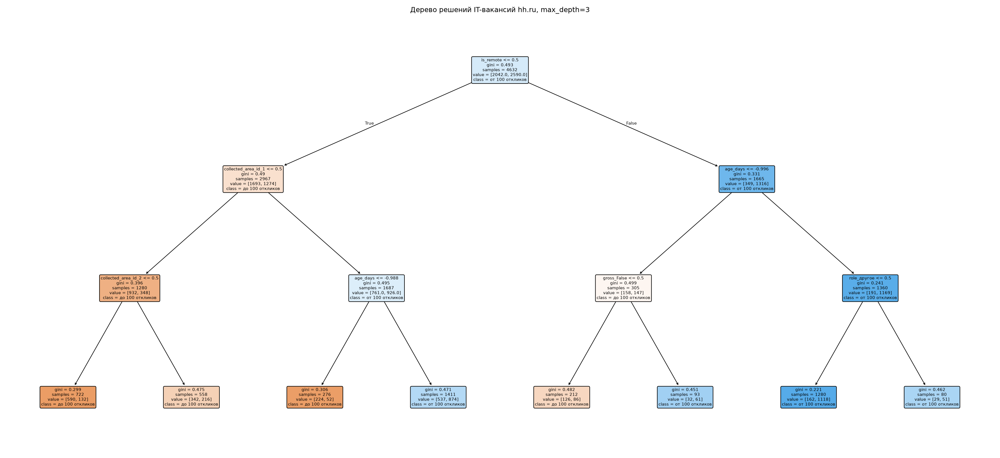

# Лабораторная 4. Бинарная классификация: дерево и kNN

Определяем, перегружена ли IT-вакансия откликами соискателей. Ответ `overloaded`: 0 — откликнулось меньше 100 человек, 1 — от 100 и больше. Порог задан заранее: медиана числа откликов у IT-вакансий — 127, поэтому классы почти равны (55,9% перегруженных).

Вся предобработка вынесена из лабораторной: заранее собирается отдельный датасет — только IT-вакансии, с ролью по названию (фронтенд, бэкенд, devops и т.д.) и полностью числовыми признаками.

## Данные и запуск

Исходный набор — [Russian Job Market Vacancies from hh.ru (2026) на Kaggle](https://www.kaggle.com/datasets/anastasiavdovina/russian-job-market-vacancies-from-hh-ru-2026), файл `../hh-data/hh_vacancies_2026_07.csv` ([описание и повторная загрузка](../hh-data/readme.md)).

Скрипт `../hh-data/build_it_dataset.py` запускается один раз и собирает `../hh-data/it_vacancies.csv`:

1. Отбираются вакансии категории «Информационные технологии» (5850) и удаляются шаблонные повторы объявлений — остаётся 5790 строк.
2. По названию вакансии определяется роль по ключевым словам (`ROLE_RULES`): фронтенд, бэкенд, 1С, devops и инфраструктура, данные и аналитика, управление разработкой, мобильная разработка, QA и тестирование, безопасность, дизайн; нераспознанные — «другое» (9,3%).
3. Считается цель `overloaded` = `responses_count >= 100` (счётчик откликов в признаки не попадает).
4. Нормализация: `salary_from_rub` заполняется медианой IT-вакансий; `age_days` (возраст вакансии на момент сбора), `title_len` и зарплата приводятся к z-оценке; категории (роль, опыт, регион, занятость, период зарплаты, `gross`, топ-6 графиков и дли смен) кодируются one-hot; остальные флаги приводятся к 0/1.

На выходе таблица 5790 × 66 без пропусков, где все признаки числовые. Исходный CSV не изменяется.

```powershell
cd D:\BSTU\7sem\IOAD
python -m pip install -r requirements.txt
python hh-data\build_it_dataset.py
python lab4\lab4.py
```

Для запуска без окон: `$env:LAB4_NO_SHOW='1'`. После запуска настройку можно убрать: `Remove-Item Env:LAB4_NO_SHOW`. Картинки сохраняются рядом со скриптом независимо от открытия окон.

## Что происходит в коде

1. Читается готовый `it_vacancies.csv` (5790 строк, 66 столбцов, пропусков нет). Печатается таблица «роль и доля перегруженных вакансий» — прямой ответ на вопрос, какие роли сейчас перегружены соискателями.
2. Из таблицы берутся `y = df["overloaded"]` и матрица признаков `X` (63 столбца). Служебные столбцы `role` (текстовая роль для отчёта) и `publication_date` в `X` не входят. Нормализация уже выполнена при сборке датасета.
3. `train_test_split` делит выборку на 80% обучения и 20% test с сохранением доли классов (`stratify=y`, `random_state=42`). Из 80% берётся 75% — train, остальное — validation.
4. Обучаются базовые `DecisionTreeClassifier` и `KNeighborsClassifier`, их точность считается на train и validation.
5. Перебираются глубины 1–12 и `k` из `[1, 3, 5, 7, 9, 11, 15, 21, 31]`, строятся графики ошибок.
6. `np.argmin()` находит минимальную ошибку validation. Лучшие модели обучаются на всех 80% и проверяются на test. `ConfusionMatrixDisplay` рисует матрицы ошибок, `classification_report` выводит precision, recall и F1.
7. Итоговая таблица метрик сохраняется в `metrics.csv`.
8. Для читаемого рисунка обучается отдельное дерево глубины 3; его правила сохраняются в `tree_rules.txt`.
## Полученные результаты

На validation выбраны `max_depth=4` и `k=31`; лучшей оказалась модель дерева.

| Модель | Accuracy train | Accuracy test | F1 «от 100 откликов» на test |
|---|---:|---:|---:|
| Дерево | 0.7494 | 0.7478 | 0.7814 |
| kNN | 0.7554 | 0.7461 | 0.7835 |

Базовый прогноз большинством даёт на test 0.5587; обе модели заметно лучше (≈0.75). Train и test почти совпадают — переобучения нет. У базового неограниченного дерева train=1.0 при validation=0.68 — вот оно, и ограничение глубины до 4 его убирает. У дерева глубины 3 для рисунка accuracy test = 0.7332.

Самые важные признаки итогового дерева: `is_remote` (0.41), `age_days` (0.26), московский регион `collected_area_id_1` (0.16), `role_другое` (0.08). Удалённые вакансии и вакансии, дольше висящие в поиске, набирают больше откликов; зарплата на число откликов почти не влияет (важность 0.00).

Таблица по ролям (шаг 1) показывает, что выше всего доля перегруженных вакансий у фронтенда (90,3%), данных и аналитики (69,0%) и бэкенда (58,5%); ниже всего у 1С (26,7%), «другого» (29,9%) и безопасности (33,3%). Высокая доля откликов означает конкуренцию среди соискателей на каждую вакансию, а не дефицит вакансий.

Подробный вывод запуска — `results.txt`, итоговая таблица — `metrics.csv`.










## Ответы на вопросы

1. **Классификация** — выбор класса объекта по его признакам. Здесь два класса: вакансия перегружена откликами (от 100) или нет (до 99).
2. **Обучение с учителем** использует примеры с известными ответами: матрицу признаков X и вектор меток y. Здесь метки получены из числа откликов вакансии.
3. **Разделение выборки** нужно для проверки на объектах, которые модель не видела. validation используется для выбора параметров, test — для итоговой оценки.
4. **Переобучение** — запоминание особенностей train при слабом результате на новых данных. Базовое дерево получило train=1.0 и validation=0.68. Для дерева помогают ограничение глубины и числа объектов в листе; для kNN — увеличение числа соседей.
5. **Обобщающая способность** — способность правильно отвечать на новых объектах. Высокая точность на train сама по себе её не доказывает.
6. **Матрица ошибок** считает сочетания фактического и предсказанного класса. Строки — фактические классы, столбцы — прогнозы. Диагональ содержит верные ответы. При положительном классе «от 100 откликов»: TP — правильно предсказанная перегруженная вакансия, TN — правильно неперегруженная, FP — ошибочно названная перегруженной, FN — пропущенная перегруженная.
7. **Accuracy** = доля верных ответов; **precision** = TP / (TP + FP); **recall** = TP / (TP + FN). F1 объединяет precision и recall через гармоническое среднее.
8. **Дерево** проверяет условия по признакам и порогам. Оно выбирает разбиение с наибольшим уменьшением взвешенной неоднородности дочерних узлов. `gini = 1 - p(до 100 откликов)^2 - p(от 100 откликов)^2`: ноль в чистом узле, максимум 0.5 при равных долях. Отдельный дочерний узел может оказаться более смешанным, чем родитель; уменьшается взвешенное значение для всего разбиения.

**kNN** ищет k ближайших обучающих объектов и голосует по их классам. Все признаки уже масштабированы при сборке датасета (z-оценка для числовых, 0/1 для остальных); без этого расстояние почти целиком определяла бы зарплата в сотнях тысяч рублей.


