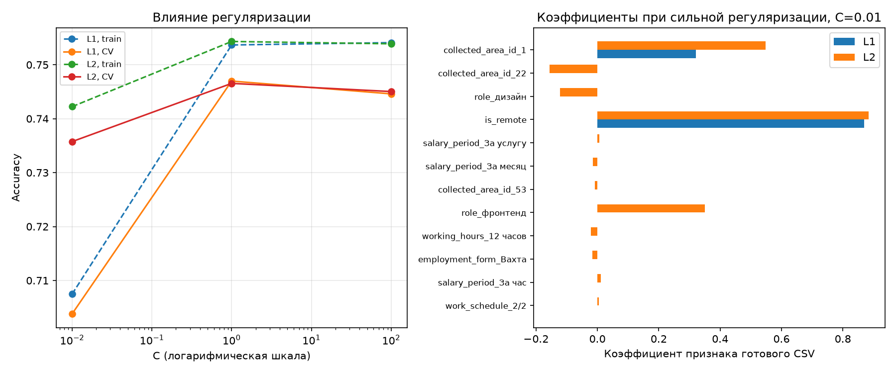
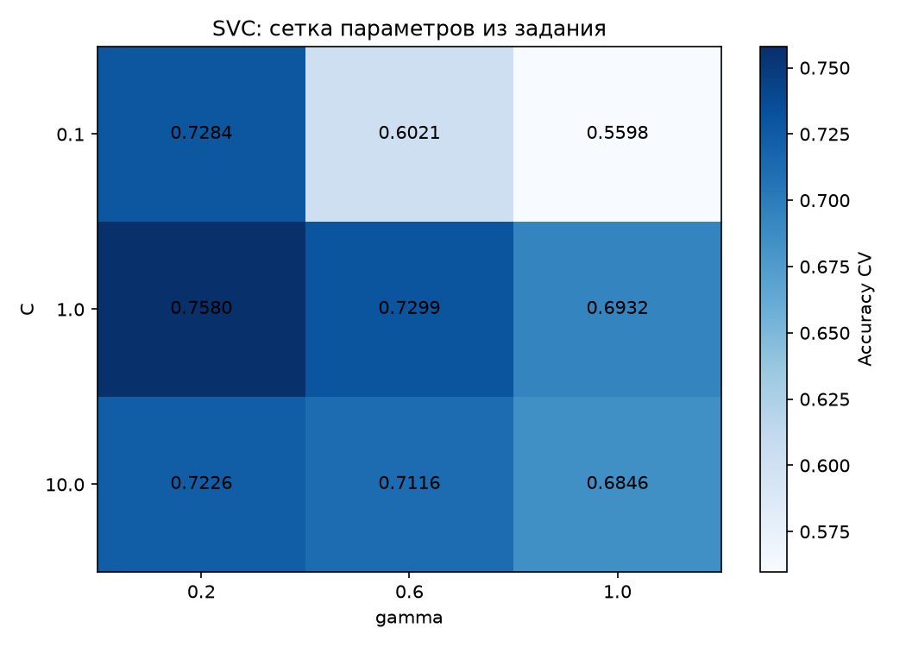
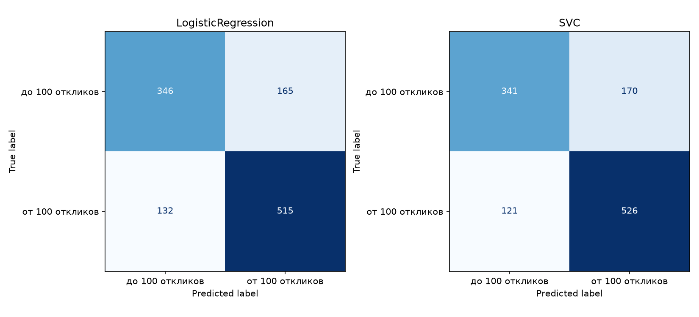
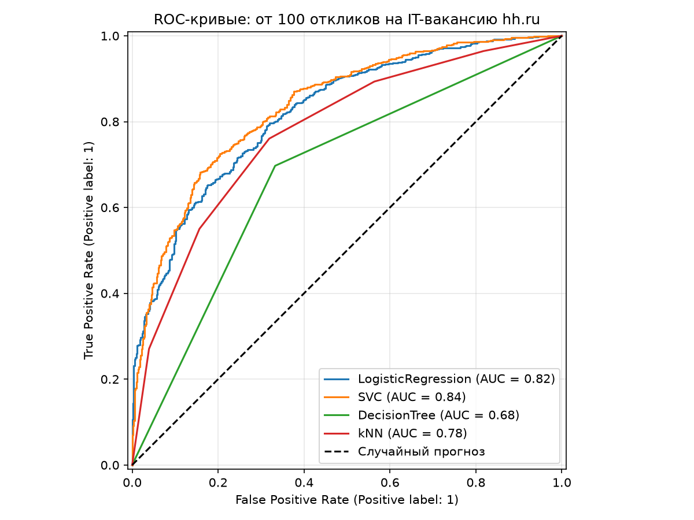

# Лабораторная работа № 5. Линейные классификаторы

На IT-вакансиях сравниваются LogisticRegression, SVC, дерево и kNN. Все пункты 1–5 находятся в одном файле `lab5.py`.

## Запуск

```powershell
cd D:\BSTU\7sem\IOAD
.\.venv\Scripts\python.exe lab5\lab5.py
```

Для запуска без окон с сохранением вывода:

```powershell
$env:LAB5_NO_SHOW='1'
$env:PYTHONUTF8='1'
.\.venv\Scripts\python.exe -u lab5\lab5.py | Out-File lab5\results.txt -Encoding utf8
Remove-Item Env:LAB5_NO_SHOW, Env:PYTHONUTF8
```

Проверено 19.10.2026: Python 3.11.9, scikit-learn 1.9.0; зависимости — в общем `../requirements.txt`. Графики сохраняются рядом со скриптом; при обычном запуске открываются окна matplotlib.

## 1. Готовые данные

Используется только готовый `../hh-data/it_vacancies.csv`: **5790 строк, 66 столбцов, пропусков нет**. Сырой CSV не читается и не пересобирается. `overloaded` — ответ (0: меньше 100 откликов, 1: от 100 на момент сбора); `role` и `publication_date` — служебные столбцы. После их исключения остаются **63 числовых признака**: три непрерывных показателя, бинарные флаги и one-hot-категории, включая `role_*`.

Заполнение зарплаты, кодирование категорий и стандартизация `age_days`, `title_len`, `salary_from_rub` уже выполнены при сборке. Флаги и one-hot-столбцы остаются в шкале 0/1. [Описание готового датасета](../hh-data/readme.md).

Разбиение совпадает с лабораторной 4: `train_test_split(test_size=0.2, stratify=y, random_state=42)`. Train — **4632** строки (2042 класса 0, 2590 класса 1), test — **1158** (511 класса 0, 647 класса 1).

Повторных `SimpleImputer`, `StandardScaler` и `Pipeline` нет: модели работают непосредственно с готовой матрицей X, как в работе 4. Для подбора параметров используется `StratifiedKFold(n_splits=5, shuffle=True, random_state=42)` только внутри train. Выбор делается по accuracy CV, test используется для итоговой оценки.

Подготовка готового CSV выполнена по всей выборке до разбиения, включая заполнение зарплаты, выбор редких категорий и масштабирование трёх столбцов. Это ограничение независимости оценки. В CSV нет работодателя и ID для группового разделения. Случайный test не доказывает качество на новых работодателях или будущих публикациях. Возраст вакансии известен на момент сбора, поэтому задача не является прогнозом популярности сразу при публикации.

## 2. Логистическая регрессия, L1 и L2

Для каждой регуляризации проверяются C = 1, 100 и 0,01. В установленном scikit-learn 1.9.0 `l1_ratio=1` задаёт L1, `l1_ratio=0` — L2; используется `solver='liblinear'`. Указание методички про L1 по умолчанию не применяется: оба варианта заданы явно.

| Штраф | C | Accuracy CV | Accuracy train | Accuracy test | Нулевых весов |
| --- | --- | --- | --- | --- | --- |
| L1 | 1.0000 | 0.7470 | 0.7537 | 0.7435 | 16 |
| L1 | 100.0000 | 0.7446 | 0.7541 | 0.7418 | 1 |
| L1 | 0.0100 | 0.7038 | 0.7075 | 0.7159 | 55 |
| L2 | 1.0000 | 0.7465 | 0.7543 | 0.7401 | 0 |
| L2 | 100.0000 | 0.7450 | 0.7539 | 0.7418 | 0 |
| L2 | 0.0100 | 0.7357 | 0.7422 | 0.7323 | 0 |

По CV выбрана **L1, C=1**. Чем меньше C, тем сильнее регуляризация. При C=0,01 L1 обнулила 55 весов из 63, L2 — ни одного. Сильная L1 здесь ухудшает качество: остаётся слишком мало признаков.

Все коэффициенты сохранены в `coefficients.csv` и выведены в `results.txt`. Веса относятся к шкалам готового CSV: непрерывные показатели — z-оценки, флаги — 0/1. Для бинарного признака положительный вес увеличивает логарифм шансов класса 1 при переключении 0 → 1 и фиксированных остальных признаках. Связанные one-hot-столбцы не позволяют считать веса причинным эффектом.



## 3. Метод опорных векторов

Сравниваются стандартная `SVC()` (C=1, gamma='scale', RBF) и лучшая модель заданной сетки: `C=[0.1, 1, 10]`, `gamma=[0.2, 0.6, 1]`. `GridSearchCV` использует те же пять CV-разбиений и два процесса. Параметры задаются напрямую как `C` и `gamma`, без префиксов Pipeline.

| Вариант | C | Gamma | Accuracy CV | Accuracy train | Accuracy test | Выбран |
| --- | --- | --- | --- | --- | --- | --- |
| default | 1.0000 | scale | 0.7608 | 0.8018 | 0.7487 | True |
| grid_best | 1.0000 | 0.2000 | 0.7580 | 0.8333 | 0.7573 | False |

`best_score_` сетки = **0.7580**, `best_params_` = `{'C': 1, 'gamma': 0.2}`. Девять комбинаций находятся в `svc_grid.csv`. Для итоговой SVC выбрана стандартная модель: у неё выше CV accuracy. Лучший test у варианта сетки не используется как основание для выбора. Большая gamma делает влияние точки локальнее и может привести к переобучению.



## 4. Сравнение четырёх моделей

Дерево с `random_state=42` и kNN с k=5 обучаются в том же файле на тех же строках. Положительный класс для precision, recall и F1 — от 100 откликов.

| Модель | Accuracy train | Accuracy test | Precision | Recall | Специфичность | F1 | ROC AUC |
| --- | --- | --- | --- | --- | --- | --- | --- |
| LogisticRegression | 0.7537 | 0.7435 | 0.7574 | 0.7960 | 0.6771 | 0.7762 | 0.8215 |
| SVC | 0.8018 | 0.7487 | 0.7557 | 0.8130 | 0.6673 | 0.7833 | 0.8362 |
| DecisionTree | 1.0000 | 0.6839 | 0.7262 | 0.6971 | 0.6673 | 0.7114 | 0.6822 |
| kNN | 0.8096 | 0.7254 | 0.7511 | 0.7604 | 0.6810 | 0.7558 | 0.7773 |

Прогноз большинством train даёт accuracy **0,5587**. Неограниченное дерево запоминает train, но уступает на test. Матрицы ошибок в порядке классов 0, 1 (строки — факт, столбцы — прогноз):

| Модель | TN | FP | FN | TP |
| --- | --- | --- | --- | --- |
| LogisticRegression | 346 | 165 | 132 | 515 |
| SVC | 341 | 170 | 121 | 526 |
| DecisionTree | 341 | 170 | 196 | 451 |
| kNN | 348 | 163 | 155 | 492 |



## 5. ROC-кривые и вывод

На одних осях показаны четыре ROC-кривые. Для LogisticRegression и SVC используется `decision_function`, для дерева и kNN — вероятность класса 1. Включать `probability=True` у SVC не требуется.



В этом разбиении лучший ROC AUC у **SVC (0.8362)**, лучшая accuracy — у **SVC (0.7487)**. Сравнение относится к одному test готового CSV; оно не доказывает универсального превосходства модели.

## Ответы на вопросы

1. **Линейные классификаторы** принимают решение по `w*x+b`; граница — гиперплоскость. Примеры: логистическая регрессия, персептрон, линейный SVM. SVC с RBF из этой работы нелинейна в исходном пространстве.
2. **Регуляризация** ограничивает сложность модели, штрафуя большие веса. Меньше C — сильнее штраф, но слишком сильный штраф ведёт к недообучению.
3. **L1** штрафует сумму модулей весов и может обнулять их. **L2** штрафует сумму квадратов и уменьшает веса, обычно сохраняя признаки. Здесь при C=0,01 L1 обнулила 55 весов, L2 — 0.
4. **C и gamma:** большое C сильнее штрафует ошибки на train; большая gamma RBF уменьшает радиус влияния точки. Gamma не является L1/L2-штрафом. Оба параметра зависят от шкал признаков.
5. **GridSearchCV** перебирает параметры по CV; `best_params_` содержит лучший вариант сетки, `best_score_` — его среднюю оценку. Test не используют для подбора. Когда предобработку нужно обучать внутри CV, её помещают в Pipeline; здесь по условию используется уже подготовленный CSV.
6. **Чувствительность** — `TP/(TP+FN)`, **специфичность** — `TN/(TN+FP)`. Для предупреждения соискателя о высокой конкуренции важен recall, но ложные предупреждения тоже имеют цену. У выбранной SVC recall = 0,8130, специфичность = 0,6673. Precision `TP/(TP+FP)` отвечает на другой вопрос: какая доля предупреждений верна.
7. **ROC** показывает TPR в зависимости от FPR при изменении порога. **AUC** измеряет качество ранжирования: 1 — идеальное, около 0,5 — случайное. AUC=0,8362 не означает accuracy=83,62%. Порог подбирают по цели на validation, а не на test.

## Файлы результатов

`results.txt` — полный вывод; `regularization.csv`, `coefficients.csv` — шесть моделей и их веса; `svc_grid.csv`, `svc_comparison.csv` — подбор SVC; `metrics.csv`, `confusion_matrices.csv` — итоговые метрики; `predictions.csv` — индексы строк test, ответы, прогнозы и оценки для проверки результатов. Четыре PNG показаны выше.
