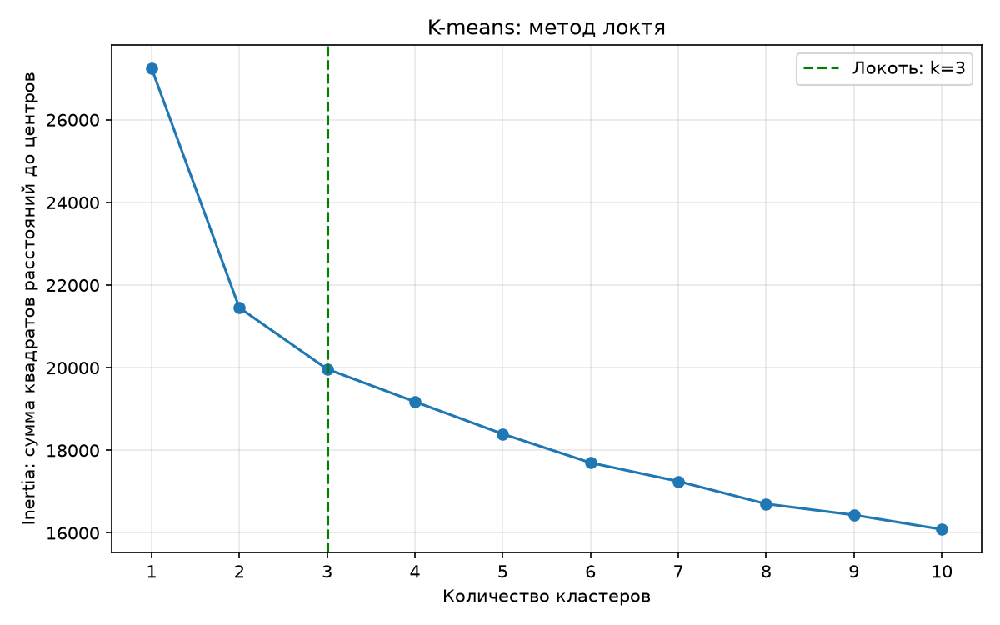
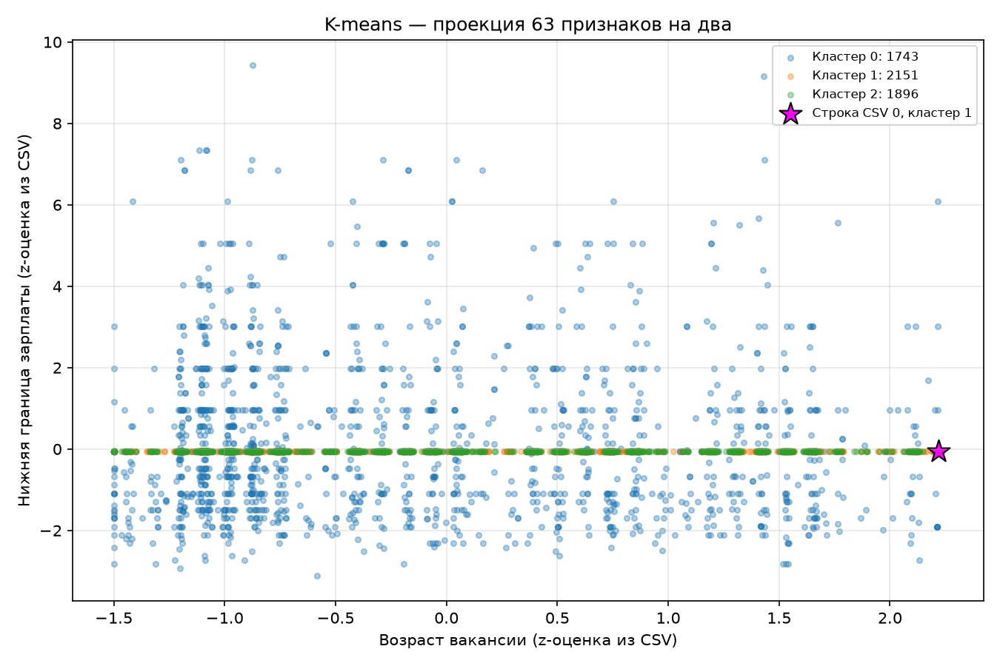
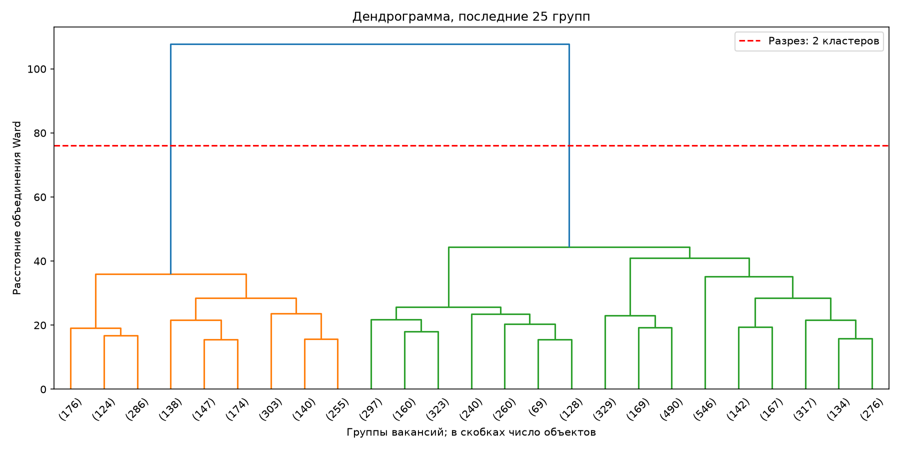
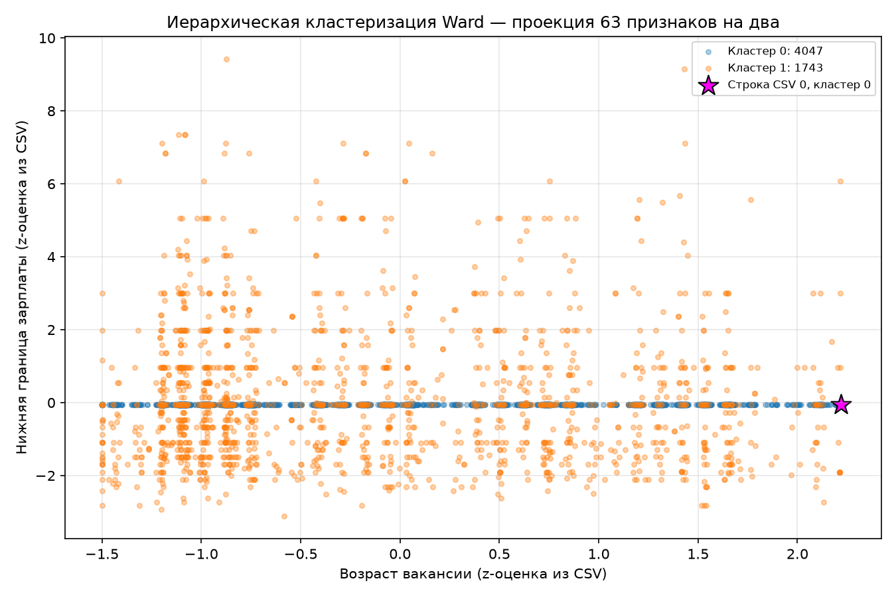
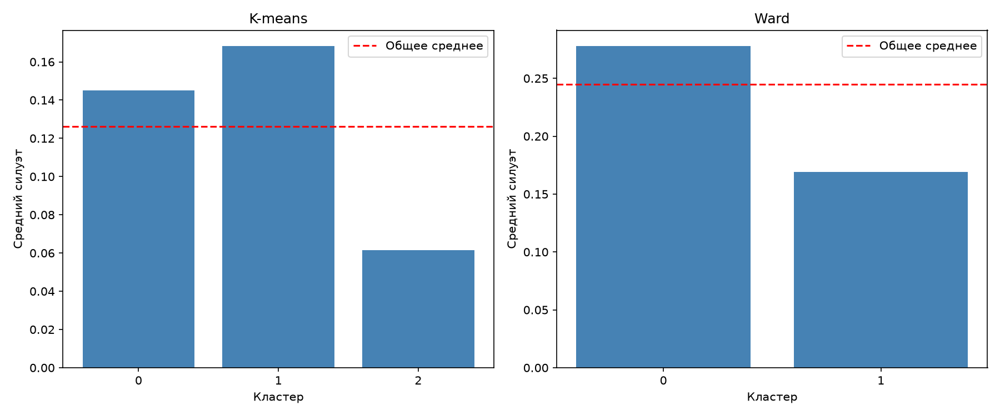

# Лабораторная работа № 6. Кластеризация IT-вакансий

Ищем группы похожих вакансий методами K-means и Ward. Ответ `overloaded` не используется при обучении или выборе кластеров.

## Запуск

```powershell
cd D:\BSTU\7sem\IOAD
.\.venv\Scripts\python.exe lab6\lab6.py
```

Для запуска без окон с сохранением вывода:

```powershell
$env:LAB6_NO_SHOW='1'
$env:PYTHONUTF8='1'
.\.venv\Scripts\python.exe -u lab6\lab6.py | Out-File lab6\results.txt -Encoding utf8
Remove-Item Env:LAB6_NO_SHOW, Env:PYTHONUTF8
```

Проверено 19.10.2026: Python 3.11.9, scikit-learn 1.9.0; зависимости — в общем `../requirements.txt`. Графики сохраняются рядом со скриптом; при обычном запуске открываются окна matplotlib.

## 1–3. Матрица признаков

Используется только готовый `../hh-data/it_vacancies.csv`: **5790 строк, 66 столбцов, пропусков нет**. Сырой CSV не читается и не пересобирается. `overloaded` — ответ (0: меньше 100 откликов, 1: от 100 на момент сбора); `role` и `publication_date` — служебные столбцы. После их исключения остаются **63 числовых признака**: три непрерывных показателя, бинарные флаги и one-hot-категории, включая `role_*`.

Заполнение зарплаты, кодирование категорий и стандартизация `age_days`, `title_len`, `salary_from_rub` уже выполнены при сборке. Флаги и one-hot-столбцы остаются в шкале 0/1. [Описание готового датасета](../hh-data/readme.md).

Используются все 63 характеристики вакансии: возраст, длина названия, зарплата, роль, опыт, регион, график и форматы работы. Удалены целевая метка, дата и текстовая копия роли. Весь CSV используется без случайной подвыборки.

Пропуски только проверяются. Повторного заполнения и кодирования нет. Один `MinMaxScaler().fit_transform(X)` сохранён как явное требование пункта 3 методички: он переводит столбцы в диапазон 0–1. Три z-признака ещё не имеют этого диапазона. У кластеризации нет train/test, scaler обучается на всей исследуемой выборке.

## 4–7. Два алгоритма

Для k от 1 до 10 вычисляется inertia K-means. Локоть выбирается как внутренняя точка с максимальным отклонением нормированной кривой от прямой между её концами. Получено **k=3**. Это эвристика выбора k, а не доказательство единственного оптимума.

Ward строится через `linkage(X_s, method='ward')`. На дендрограмме показаны последние 25 групп; разрез проходит в самом большом скачке среди последних десяти объединений. Получено **2 кластера**. `AgglomerativeClustering` строит итоговые метки с этим числом групп.

Для обоих алгоритмов графики показывают только возраст и нижнюю границу зарплаты в z-шкалах готового CSV. Обучение использует все 63 признака после MinMax, поэтому группы в этой проекции могут перекрываться. Зарплата на оси не выражена в рублях.









## 8. Качество кластеризации

Все метрики рассчитаны на всех 5790 вакансиях в одном пространстве после MinMax.

| Метод | Кластеров | Силуэт ↑ | Davies–Bouldin ↓ | Calinski–Harabasz ↑ |
| --- | --- | --- | --- | --- |
| K-means | 3 | 0.1263 | 2.4657 | 1055.3692 |
| Ward | 2 | 0.2450 | 1.7837 | 1564.4332 |

Ward лучше по всем трём метрикам в этом запуске. Даже его силуэт 0,2450 не показывает чётко изолированных типов вакансий. Сравниваются также разные числа кластеров, поэтому вывод относится к этим двум выбранным разбиениям.

Качество отдельных кластеров K-means:

| Кластер | Вакансий | Средний силуэт | Доля отрицательных |
| --- | --- | --- | --- |
| 0 | 1743 | 0.1451 | 0.0000 |
| 1 | 2151 | 0.1681 | 0.0000 |
| 2 | 1896 | 0.0615 | 0.0142 |

Качество отдельных кластеров Ward:

| Кластер | Вакансий | Средний силуэт | Доля отрицательных |
| --- | --- | --- | --- |
| 0 | 4047 | 0.2777 | 0.0000 |
| 1 | 1743 | 0.1691 | 0.0000 |



Средние признаки кластеров K-means:

| Кластер | Возраст, z | Зарплата, z | Доля с зарплатой | Доля remote | Доля hybrid |
| --- | --- | --- | --- | --- | --- |
| 0 | -0.1115 | 0.1432 | 1.0000 | 0.3609 | 0.2249 |
| 1 | 0.0553 | -0.0617 | 0.0000 | 0.3803 | 0.4658 |
| 2 | 0.0398 | -0.0617 | 0.0000 | 0.3365 | 0.4357 |

Средние признаки Ward:

| Кластер | Возраст, z | Зарплата, z | Доля с зарплатой | Доля remote | Доля hybrid |
| --- | --- | --- | --- | --- | --- |
| 0 | 0.0480 | -0.0617 | 0.0000 | 0.3598 | 0.4517 |
| 1 | -0.1115 | 0.1432 | 1.0000 | 0.3609 | 0.2249 |

Средние бинарных флагов — доли вакансий. Возраст и зарплата остаются в z-шкалах CSV. Все 63 средних сохранены в `profiles_kmeans.csv` и `profiles_ward.csv`. Группировка зависит от выбора признаков и евклидова расстояния; one-hot-блоки влияют на него совместно. Заполненная при сборке зарплата также влияет на расстояния. Результат исследовательский, без внешних эталонных меток.

В этом запуске Ward фактически разделил вакансии по наличию зарплаты: в кластере 0 все 4047 объявлений без указанной зарплаты, в кластере 1 — все 1743 с указанной. K-means также выделил 1743 объявления с зарплатой в кластер 0, а остальные разделил на две группы. Значит, алгоритмы в первую очередь обнаружили структуру заполненности данных, а не независимые типы IT-профессий. На расстояния вместе влияют связанные признаки `salary_shown`, `salary_period_*`, `gross_*` и заполненная зарплата.

## 9. Конкретный объект

Пурпурной звездой выделена **строка CSV 0** (индекс с нуля, без заголовка), дата **2026-06-10**, роль **«управление разработкой»**. Её кластер K-means — **1**, Ward — **0**. Это индекс строки готового файла, не ID вакансии hh.ru. Номера кластеров разных методов условны и не сопоставляются напрямую.

`clusters.csv` связывает строку CSV, дату и роль с метками двух методов; `elbow.csv` содержит inertia; `metrics.csv` и `silhouette_*.csv` — метрики; `results.txt` — полный вывод. Все пять PNG показаны выше.

## Ответы на вопросы

1. **Кластеризация** объединяет похожие объекты без заранее заданных ответов. Здесь группируются IT-вакансии по их характеристикам.
2. **K-means** выбирает k центров, относит точки к ближайшему центру и пересчитывает центры как средние. Эти шаги повторяются до стабилизации. `n_init=10` запускает поиск с десятью начальными положениями центров.
3. **Число кластеров** можно выбрать методом локтя, по силуэту и по смыслу полученных групп. Inertia всегда уменьшается с ростом k, поэтому её минимум сам по себе не даёт полезного выбора.
4. **Иерархическая кластеризация** начинает с отдельных объектов и постепенно объединяет группы. Ward выбирает объединение с наименьшим приростом внутрикластерного разброса.
5. **Дендрограмма** показывает порядок и расстояния объединений. Горизонтальный разрез определяет число кластеров: сколько ветвей пересекает линия, столько групп получается.
6. **Силуэт** сравнивает расстояние до своего кластера с расстоянием до ближайшего чужого: близко к 1 — хорошее разделение, около 0 — граница, меньше 0 — точке ближе чужая группа. Davies–Bouldin оценивает сходство кластеров, меньше лучше. Calinski–Harabasz сравнивает межкластерный и внутрикластерный разброс, больше лучше.
7. **Форма кластеров:** K-means предпочитает компактные группы вокруг центров. Иерархические методы зависят от правила объединения; Ward тоже склонен к компактным группам. Для вытянутых групп сложной формы и шума часто используют DBSCAN или HDBSCAN.


