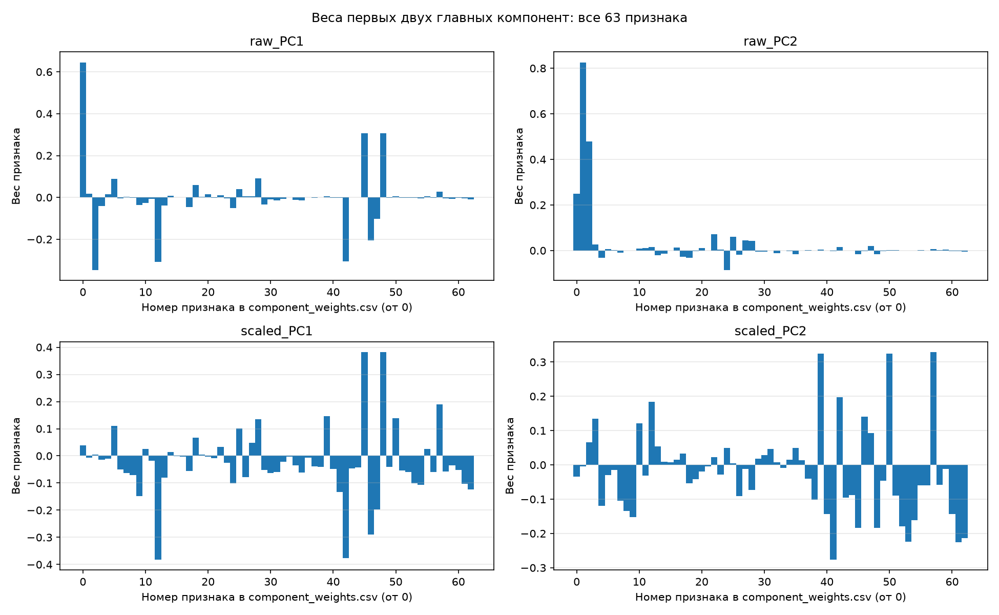
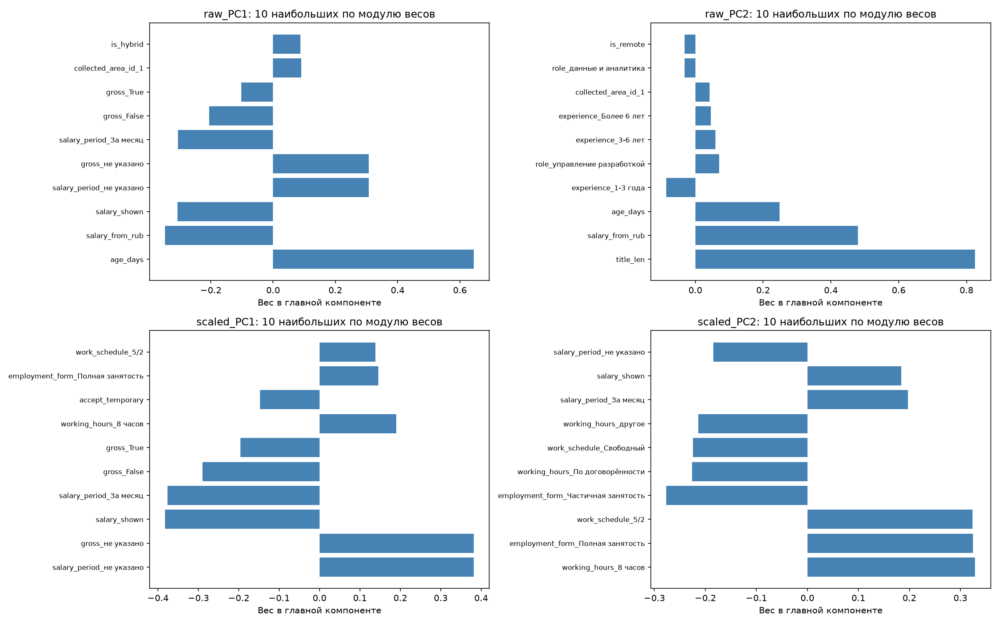
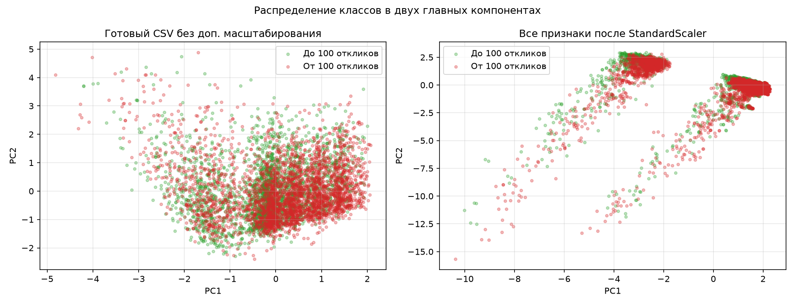
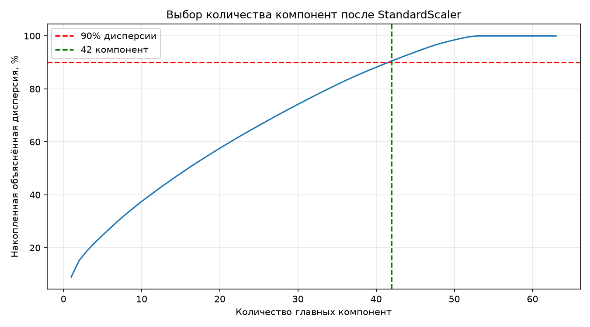
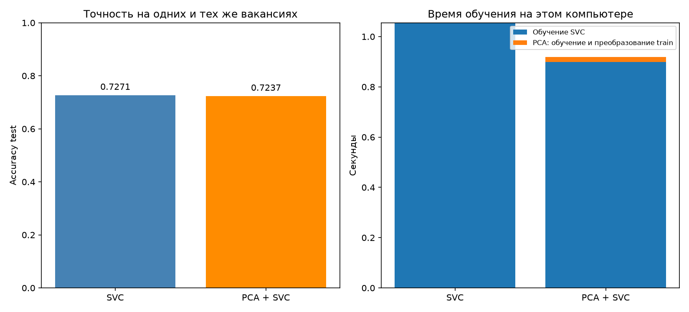

# Лабораторная работа № 7. Метод главных компонент

Сравниваем PCA на IT-вакансиях до и после дополнительной стандартизации. Затем оцениваем точность и время SVC на всех признаках и после PCA с сохранением не менее 90% дисперсии.

## Запуск

```powershell
cd D:\BSTU\7sem\IOAD
.\.venv\Scripts\python.exe lab7\lab7.py
```

Для запуска без окон с сохранением вывода:

```powershell
$env:LAB7_NO_SHOW='1'
$env:PYTHONUTF8='1'
.\.venv\Scripts\python.exe -u lab7\lab7.py | Out-File lab7\results.txt -Encoding utf8
Remove-Item Env:LAB7_NO_SHOW, Env:PYTHONUTF8
```

Проверено 19.10.2026: Python 3.11.9, scikit-learn 1.9.0; зависимости — в общем `../requirements.txt`. Графики сохраняются рядом со скриптом; при обычном запуске открываются окна matplotlib.

## 1. Готовые данные

Используется только готовый `../hh-data/it_vacancies.csv`: **5790 строк, 66 столбцов, пропусков нет**. Сырой CSV не читается и не пересобирается. `overloaded` — ответ (0: меньше 100 откликов, 1: от 100 на момент сбора); `role` и `publication_date` — служебные столбцы. После их исключения остаются **63 числовых признака**: три непрерывных показателя, бинарные флаги и one-hot-категории, включая `role_*`.

Заполнение зарплаты, кодирование категорий и стандартизация `age_days`, `title_len`, `salary_from_rub` уже выполнены при сборке. Флаги и one-hot-столбцы остаются в шкале 0/1. [Описание готового датасета](../hh-data/readme.md).

Разбиение совпадает с лабораторной 4: `train_test_split(test_size=0.2, stratify=y, random_state=42)`. Train — **4632** строки (2042 класса 0, 2590 класса 1), test — **1158** (511 класса 0, 647 класса 1).

Заполнение пропусков и кодирование категорий не повторяются. `StandardScaler` оставлен как часть эксперимента PCA по заданию. Он обучается только на train, test только преобразуется.

Подготовка готового CSV выполнена по всей выборке до разбиения, включая заполнение зарплаты, выбор редких категорий и масштабирование трёх столбцов. Это ограничение независимости оценки. В CSV нет работодателя и ID для группового разделения. Случайный test не доказывает качество на новых работодателях или будущих публикациях. Возраст вакансии известен на момент сбора, поэтому задача не является прогнозом популярности сразу при публикации.

## 2–3. Веса компонент и распределение классов

`pca_raw` обучается на X_train в шкалах **готового CSV**, `pca_scaled` — после стандартизации всех 63 столбцов. Имена `raw_PC1/2` в `component_weights.csv` означают отсутствие дополнительного масштабирования, а не исходные рубли и дни: три непрерывных признака уже были стандартизированы при сборке. Это не восстановление сырой таблицы hh.ru.

У one-hot-столбцов разные частоты и дисперсии. Дополнительная стандартизация меняет их вклад, особенно усиливая редкие категории. Поэтому сравнение остаётся содержательным, хотя CSV уже подготовлен. PCA и scaler обучаются только на train; для рисунка преобразуются все вакансии, точки окрашены по `overloaded`.

Четыре диаграммы показывают веса PC1/PC2 до и после StandardScaler. Дополнительный рисунок показывает десять наибольших по модулю весов. Знак компоненты условен и может быть инвертирован вместе со всеми весами. Проекции двух классов перекрываются: PCA сохраняет дисперсию X, а не ищет разделяющую границу по y.

В шкалах готового CSV первые две компоненты объясняют **28,41%** дисперсии; после StandardScaler — **15,14%**. В первом случае выделяются возраст, длина названия и зарплатные поля, во втором заметны также занятость, график и рабочие часы. Масштабирование перераспределило вклад столбцов, но не обеспечило разделение классов.







## 4–5. SVC до и после PCA

В обоих вариантах используется `SVC(C=1, gamma='scale')` и одна стандартизированная матрица признаков. Это позволяет сравнить влияние PCA. В работе 5 SVC работает непосредственно с готовым CSV, поэтому её метрики могут отличаться от базовой SVC здесь, даже при одинаковом test.

Число компонент определяется по накопленной `explained_variance_ratio_` на train: нужны **42 компоненты из 63**, сохраняющие **90.53%** дисперсии. Предыдущая компонента ещё не достигает 90%. Кривая сохранена в `explained_variance.csv`.



| Вариант | Признаков | Accuracy test | ROC AUC | PCA, с | SVC, с | Вместе, с |
| --- | --- | --- | --- | --- | --- | --- |
| SVC | 63 | 0.7271 | 0.8120 | 0.0000 | 1.0551 | 1.0551 |
| PCA + SVC | 42 | 0.7237 | 0.8061 | 0.0201 | 0.8982 | 0.9183 |

Изменение accuracy: **-0.35 процентного пункта**. Отношение времени SVC к сумме PCA+SVC — **1.15**. В этом запуске сокращение размерности дало небольшое ускорение и небольшую потерю качества. Сохранение 90% дисперсии не гарантирует сохранения информации о классах.

`perf_counter()` отдельно измеряет обучение SVC и обучение PCA с преобразованием train. Общие чтение CSV и масштабирование, преобразование test и исследовательские PCA для графиков в таблицу времени не входят. Это один замер на этом компьютере (число потоков OMP/BLAS/MKL ограничено двумя при проверке); небольшая разница времени может меняться от запуска к запуску.



`component_weights.csv` содержит 63 веса первых двух компонент каждого варианта; `explained_variance.csv` — дисперсии; `metrics.csv` — качество и время; `predictions.csv` — индексы test, ответы, прогнозы и оценки обеих моделей; `results.txt` — полный вывод. Все пять PNG показаны выше.

## Ответы на вопросы

1. **Преимущества уменьшения размерности.** Меньше памяти и вычислений, проще визуализация, можно убрать шум и зависимые признаки. Иногда уменьшается переобучение. Но вместе с лишними направлениями можно потерять полезную информацию; поэтому точность надо проверять отдельно.
2. **Feature Selection и Feature Extraction.** Отбор признаков оставляет часть исходных столбцов, например по корреляции или важности в модели. Смысл оставшихся столбцов сохраняется. Извлечение признаков создаёт новые параметры из исходных; PCA строит линейные комбинации. Новые координаты компактнее, но их сложнее объяснять.
3. **Принцип PCA.** Данные центрируются, затем находятся ортогональные направления наибольшей дисперсии. Это собственные векторы ковариационной матрицы; на практике можно использовать SVD. Первая компонента сохраняет максимально возможную дисперсию, следующая — максимально возможную среди направлений, перпендикулярных предыдущим. Выбираются первые k направлений и данные проецируются на них. Метод не использует ответы y, поэтому масштабирование и проверка результата классификации важны.
4. **Главная компонента.** Новая координата объекта — взвешенная сумма центрированных исходных признаков. Веса задают направление в пространстве признаков, а значение компоненты показывает положение объекта вдоль этого направления. Разные компоненты ортогональны и на обучающих данных некоррелированы.

Пример из условия: [масштабирование перед PCA в scikit-learn](https://scikit-learn.org/stable/auto_examples/preprocessing/plot_scaling_importance.html).


