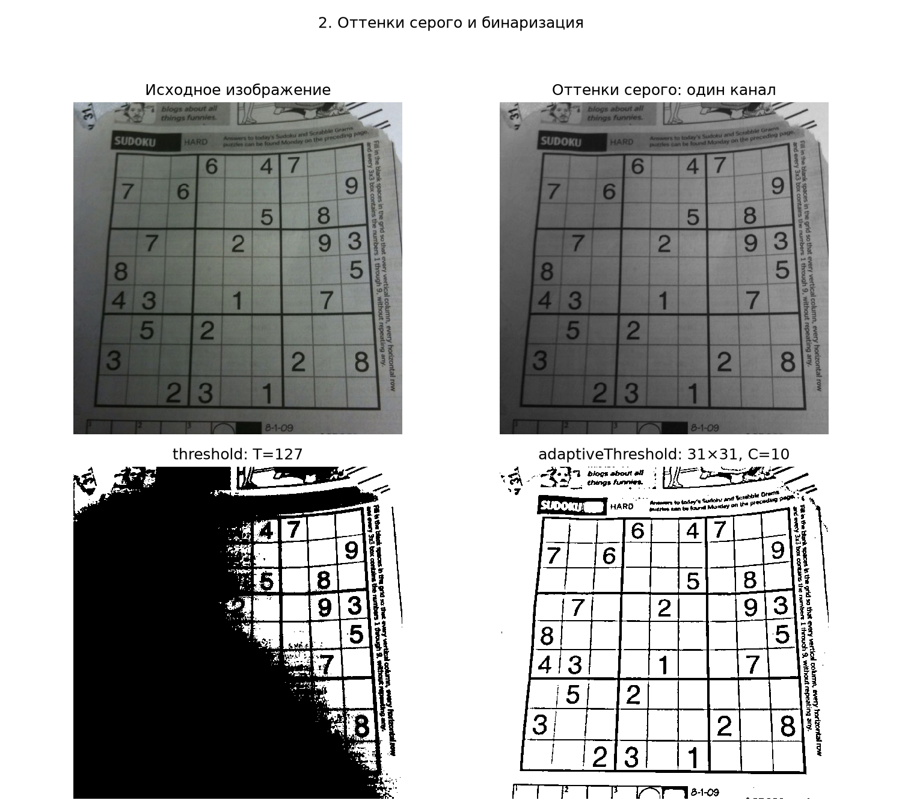
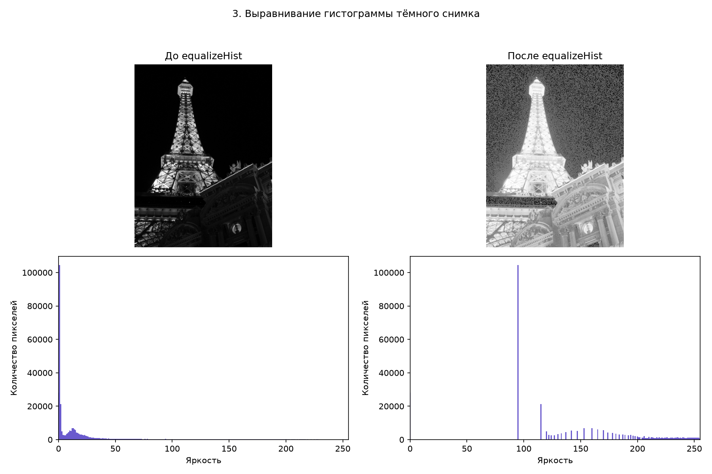
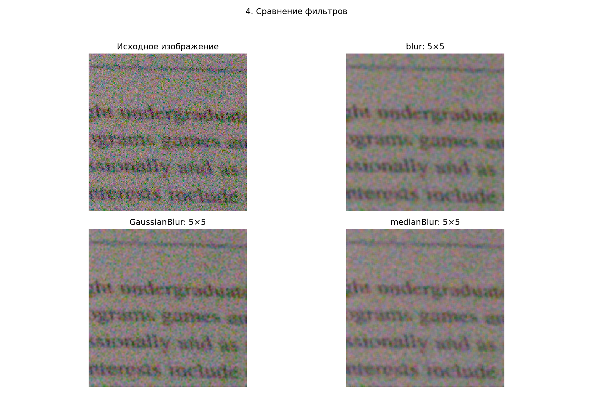
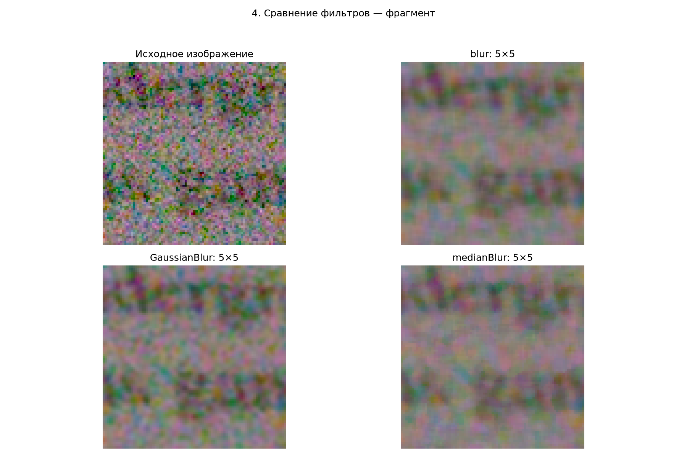
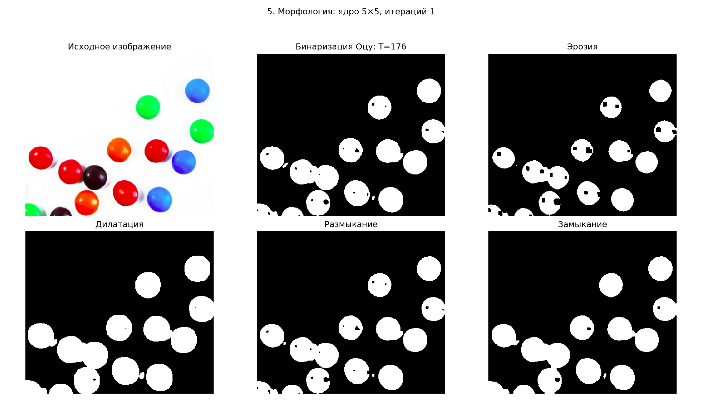

# Лабораторная работа № 8. Предобработка изображений

`lab8.py` — один последовательный скрипт: настройки, загрузка фотографий, задания 2–5 и сохранение результатов. При запуске открывает пять сравнительных рисунков Matplotlib и сохраняет результаты в `output`. Пользовательских функций и параметров командной строки нет.

## Установка и запуск

Из корня `D:\BSTU\7sem\IOAD`:

```powershell
.\.venv\Scripts\python.exe -m pip install -r lab8\requirements.txt
.\.venv\Scripts\python.exe lab8\lab8.py
```

Если окружения ещё нет, предварительно выполните `python -m venv .venv`. Все настройки меняются непосредственно в начале `lab8.py`:

```python
SHOW_PLOTS = True  # False — только сохранить файлы, без показа окон
THRESHOLD = 127
BLOCK_SIZE = 31
C = 10
FILTER_SIZE = 5
MORPH_SIZE = 5
ITERATIONS = 1
```

Размеры `BLOCK_SIZE`, `FILTER_SIZE` и `MORPH_SIZE` задавайте нечётными и не меньше 3; `THRESHOLD` — от 0 до 255, `ITERATIONS` — положительное целое. В `output/results.txt` автоматически сохраняется короткий отчёт в UTF-8.

Используются Python 3.11, OpenCV 4.13.0, NumPy 2.4.3 и Matplotlib 3.11.1. Зависимости лабораторной вынесены отдельно, чтобы не менять версии предыдущих работ. Руководство из условия относится к OpenCV 2.4; здесь используются актуальные вызовы OpenCV 4 с теми же названиями операций.

## Исходные фотографии

В `images` включены демонстрационные фотографии из открытых репозиториев: судоку, ночной снимок, шумный фрагмент и конфеты на белом фоне. Источники и контрольные суммы — в [описании изображений](images/readme.md) и `images/sources.json`. При запуске интернет не нужен. Исходники не затемняются и не зашумляются программой.

По условию предпочтительны собственные фотографии. Чтобы использовать их, замените четыре пути в начале скрипта:

```python
ORIGINAL_PATH = Path("D:/Photos/обычное.jpg")
DARK_PATH = Path("D:/Photos/сумерки.jpg")
NOISY_PATH = Path("D:/Photos/шумный.jpg")
OBJECTS_PATH = Path("D:/Photos/предметы.jpg")
```

Для задания 3 снимите сцену в темноте без вспышки; для 4 — кадр с заметным шумом, например при высоком ISO; для 5 — тёмные мелкие предметы на белой бумаге с равномерным освещением. Выбирайте JPG или PNG: HEIC должен быть предварительно экспортирован в поддерживаемый формат. Файлы с кириллицей в путях поддерживаются через `np.fromfile` / `cv2.imdecode`.

## 2. Оттенки серого и два способа бинаризации

`original` — массив BGR формы `(H, W, 3)`. Вызов `cv2.cvtColor(original, cv2.COLOR_BGR2GRAY)` создаёт `gray` формы `(H, W)`, то есть **один канал**, а не три одинаковых канала. Тип — `uint8`, яркости 0–255. Для показа цветных снимков Matplotlib получает RGB через отдельный `cvtColor`, иначе красный и синий поменялись бы местами.

```python
_, binary = cv2.threshold(gray, 127, 255, cv2.THRESH_BINARY)
adaptive = cv2.adaptiveThreshold(
    gray, 255, cv2.ADAPTIVE_THRESH_GAUSSIAN_C,
    cv2.THRESH_BINARY, 31, 10)
```

В `binary` пиксель белый, если `gray[y, x] > 127`, иначе чёрный. Равенство порогу относится к чёрному. В `adaptive` порог зависит от взвешенного среднего яркостей в окрестности 31×31 за вычетом 10. Это полезно для судоку: лист освещён неравномерно, поэтому один глобальный порог теряет часть сетки или фона. Размер окрестности — нечётный, больше 1.

Параметры задаются переменными `THRESHOLD`, `BLOCK_SIZE`, `C`. Все чёрно-белые рисунки показаны в фиксированной шкале 0–255 без автоматической подстройки яркости. [Пороговая бинаризация в OpenCV](https://docs.opencv.org/4.x/d7/d4d/tutorial_py_thresholding.html).



## 3. Гистограмма и equalizeHist

`dark_gray` — одноканальная версия тёмной фотографии. `equalized = cv2.equalizeHist(dark_gray)` перераспределяет уровни яркости по накопленной гистограмме. `cv2.calcHist` строит 256 столбцов; высота столбца — число пикселей с данной яркостью. У двух графиков одинаковые пределы обеих осей, поэтому их можно сравнивать непосредственно.

Функция изменяет **глобальный контраст**, а не физическое освещение сцены. Гистограмма после обработки не обязана быть идеально равномерной: дискретные уровни могут образовать пики и пропуски. Детали, уже потерянные в полностью чёрных участках, восстановить невозможно; шум в тенях может усилиться. На цветном снимке следует обрабатывать канал яркости, а не независимо выравнивать B, G, R. В задании используется серое изображение, которое непосредственно подходит для `equalizeHist`. [Выравнивание гистограммы](https://docs.opencv.org/4.x/d5/daf/tutorial_py_histogram_equalization.html).



В проверенном запуске 03.11.2026 средняя яркость изменилась с **23,42 до 133,19**, стандартное отклонение — с **45,19 до 65,83**. Нижние детали здания стали заметнее, но тёмное небо после обработки выглядит шумным, а освещённая башня слишком светлой. Это пример ограничения глобального выравнивания, а не доказательство безусловного улучшения фотографии.

Среднее и стандартное отклонение яркости записаны в `output/results.txt`; полные гистограммы — в `output/histograms.csv`. `std` описывает разброс яркости, но само по себе не доказывает улучшение качества.

## 4. Сравнение фильтров

Все три фильтра **независимо** получают один исходный `noisy`, а не результат предыдущего фильтра. Размер окрестности одинаковый — 5×5; задаётся переменной `FILTER_SIZE`.

| Вызов | Принцип | Ожидаемый эффект |
| --- | --- | --- |
| `cv2.blur(noisy, (5, 5))` | Среднее 25 пикселей с одинаковыми весами | Подавляет мелкие колебания, размывает границы |
| `cv2.GaussianBlur(noisy, (5, 5), 0)` | Среднее с гауссовыми весами; sigma определяется по ядру | Сглаживает шум, сильнее учитывая центр |
| `cv2.medianBlur(noisy, 5)` | Медиана значений окрестности отдельно в каждом канале | Убирает выбросы, полезен для импульсного шума; может терять тонкие детали |

Для цветного снимка обработка выполняется по каналам. Дополнительно сохраняется центральный фрагмент каждого результата с одинаковыми координатами. Он увеличен только при показе; фильтры работают с исходным разрешением. Без чистого эталона нельзя посчитать достоверные PSNR/SSIM или объявить универсально лучший фильтр. [Сглаживание изображений в OpenCV](https://docs.opencv.org/4.x/d4/d13/tutorial_py_filtering.html).





## 5. Эрозия и дилатация

Предметы темнее светлого фона. Поэтому `threshold(objects_gray, 0, 255, THRESH_BINARY_INV | THRESH_OTSU)` автоматически выбирает порог методом Оцу и инвертирует результат: **предметы — белые, фон — чёрный**. Это соглашение важно для правильной интерпретации морфологии.

Прямоугольное ядро создаётся через `getStructuringElement(MORPH_RECT, (MORPH_SIZE, MORPH_SIZE))`. `eroded = erode(mask, kernel, iterations=ITERATIONS)` и `dilated = dilate(mask, kernel, iterations=ITERATIONS)` независимо применяются к исходной бинарной маске. Эрозия уменьшает белые области; дилатация увеличивает их. Светлые блики на конфетах могут превратиться в чёрные отверстия — это ограничение пороговой сегментации, а не ошибка морфологии.

Для ответов на вопросы также показаны размыкание `MORPH_OPEN` и замыкание `MORPH_CLOSE`. Размыкание удаляет мелкие белые детали; замыкание заполняет небольшие чёрные отверстия. Реальный эффект определяется размером ядра относительно деталей. Количество белых пикселей каждого варианта сохранено в `results.txt`. [Морфологические операции](https://docs.opencv.org/4.x/d9/d61/tutorial_py_morphological_ops.html).

На включённой фотографии порог Оцу — **176**. Число белых пикселей: исходная маска **28 929**, эрозия **22 623**, дилатация **34 942**, размыкание **28 765**, замыкание **29 342**. Эрозия и дилатация действительно изменяют размер переднего плана в ожидаемых направлениях.



## Сохранённые результаты

| Файлы внутри `output` | Содержимое |
| --- | --- |
| `step2_thresholds.png` | Исходник, серое, глобальный и адаптивный пороги |
| `step3_equalization.png` | Тёмное и выровненное изображения, обе гистограммы |
| `step4_filters.png`, `step4_filter_details.png` | Три фильтра и исходник, общий вид и фрагмент |
| `step5_morphology.png` | Исходник, маска, эрозия, дилатация, размыкание, замыкание |
| `processed/*.png` | 13 отдельных изображений в исходном разрешении |
| `histograms.csv` | Яркость 0–255 и число пикселей до/после выравнивания |
| `results.txt` | Протокол запуска на русском в UTF-8 |

После упрощения скрипт повторно запущен: результаты обработки всех 13 отдельных изображений совпадают с предыдущей версией.

## Ответы на вопросы

1. **Какой класс отвечает за работу с изображением?** В C++ OpenCV — `cv::Mat`. В данном Python-приложении изображения представлены массивами `numpy.ndarray`: цветное — `(H, W, 3)`, серое — `(H, W)`, тип `uint8`. Старые примеры с `IplImage` относятся к устаревшему C API. [Свойства изображений в OpenCV-Python](https://docs.opencv.org/4.x/d3/df2/tutorial_py_basic_ops.html).

2. **Какая функция меняет цветовое пространство?** `cv2.cvtColor(src, code)`. Здесь `COLOR_BGR2GRAY` переводит BGR в серое, `COLOR_BGR2RGB` готовит цветной снимок для Matplotlib. Другие коды позволяют переходить в HSV, Lab, YCrCb.

3. **Что означает `thresh`?** Это порог яркости в `threshold`. При `THRESH_BINARY` значение строго больше `thresh` заменяется на `maxval`, остальные — на 0. При `THRESH_BINARY_INV` результат обратный. В режиме Оцу входной `thresh` не используется, функция сама возвращает выбранный порог первым результатом.

4. **Как работает адаптивная бинаризация?** Для каждого пикселя рассчитывается свой порог по локальной окрестности. `ADAPTIVE_THRESH_MEAN_C` использует среднее, `ADAPTIVE_THRESH_GAUSSIAN_C` — взвешенное среднее с гауссовыми весами; затем вычитается `C`. Это позволяет учитывать медленно меняющееся освещение, но мелкий шум также может попасть в результат.

5. **Что такое гистограмма и что она показывает?** Распределение количества пикселей по яркостям. Преобладание малых значений указывает на тёмный снимок, больших — на светлый; узкий диапазон часто соответствует низкому контрасту. Пики у 0 или 255 могут указывать на обрезку теней или светов, но зависят от сцены. Гистограмма не хранит пространственное расположение пикселей: разные изображения могут иметь одинаковую гистограмму.

6. **Как выровнять освещённость?** Для тональной коррекции используют растяжение контраста, глобальное `equalizeHist`, локальное CLAHE, гамма-коррекцию. При неоднородном освещении можно оценить плавный фон и компенсировать его, например вычитанием/делением, либо использовать Retinex. Глобальная коррекция контраста не гарантирует устранения теней. В работе реализован требуемый `equalizeHist`; CLAHE и остальные методы здесь только перечислены.

7. **Принцип матричных фильтров и свёртка.** Ядро перемещается по изображению; в каждой позиции значения соседей умножаются на коэффициенты ядра и суммируются. Для свёртки `g(x,y) = ΣᵢΣⱼ K(i,j) f(x−i,y−j)`. На границах задаётся способ продолжения изображения. Технически `filter2D` OpenCV выполняет корреляцию без переворота ядра; для симметричных ядер среднего и Гаусса результат совпадает со свёрткой. Не любой локальный фильтр является линейной свёрткой: медианный фильтр нелинейный.

8. **Медианный фильтр и отличие от Гаусса.** Медианный фильтр сортирует значения окрестности и берёт среднее по порядку значение. Для 5×5 это 13-е из 25 значений, а не их среднее арифметическое. Он устойчив к отдельным резким выбросам и часто лучше сохраняет перепады яркости при импульсном шуме. Фильтр Гаусса вычисляет взвешенную сумму, поэтому выброс влияет на соседние значения; он подходит для сглаживания гауссовского шума. Оба метода могут уничтожать мелкие детали; результат зависит от шума и размера ядра.

9. **Какие есть морфологические преобразования?** Эрозия, дилатация, размыкание, замыкание, морфологический градиент (`dilate − erode`), белая шляпа (`original − opening`), чёрная шляпа (`closing − original`). В OpenCV — `erode`, `dilate`, `morphologyEx` с соответствующим кодом.

10. **Какой эффект на бинарном изображении?** Если объект белый, эрозия оставляет белым пиксель только тогда, когда вся активная окрестность ядра белая: область сжимается, тонкие связи могут исчезать. Дилатации достаточно одного белого соседа: область расширяется, близкие части могут соединяться. Белый передний план принципиален; при чёрных объектах смысл эффекта на объекты меняется.

11. **Когда нужны замыкание и размыкание?** Размыкание — эрозия, затем дилатация тем же ядром: удалить маленькие белые шумовые точки и тонкие выступы/связи. Замыкание — дилатация, затем эрозия: заполнить маленькие чёрные отверстия и узкие разрывы. Размер ядра должен соответствовать нежелательным деталям, иначе исчезнут полезные части или сольются соседние предметы. Обратная операция не восстанавливает все удалённые детали, поэтому эти композиции не равны исходной маске.

Исходное руководство из задания: [Image Processing in OpenCV 2.4](https://opencv24-python-tutorials.readthedocs.io/en/latest/py_tutorials/py_imgproc/py_table_of_contents_imgproc/py_table_of_contents_imgproc.html).
