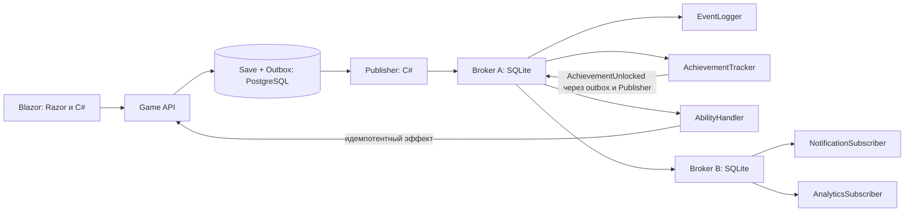

# ЛР №6. Тихая библиотека: Publish/Subscribe на C#

> Текущий основной запуск: `docker compose -f docker-compose.legacy.yml --profile pubsub up -d --build`.
> Скрипты по умолчанию управляют контейнерами; исходный процессный режим включается
> флагом `-Local`. См. [инструкцию ЛР7+ЛР8](labs-7-8-docker.md).

Это дополнение к Burmalda и ЛР №5. RabbitMQ продолжает обслуживать существующие бизнес-сервисы. Игровые события проходят через собственные C#-брокеры по HTTP. Код правил, Publisher, подписчиков, очередей, повторов, клиента сцены и лабораторной страницы написан на C#.

## Запуск

Требуются .NET SDK 9.0.300 с последним установленным patch, PowerShell 7.4+, Docker Desktop и браузер с WebGL2. Из корня проекта:

```powershell
./tools/Start-PubSubLab.ps1
# Повторный запуск без сборки:
./tools/Start-PubSubLab.ps1 -NoBuild
```

Откройте `http://localhost:5300/library-game` или `http://localhost:5300/pubsub-lab`. Войдите существующим аккаунтом Burmalda или зарегистрируйте локальный. Лаборатория использует отдельное демонстрационное сохранение этого аккаунта. Каталог, кредиты BD и обычное игровое прохождение от опытов не меняются.

Скрипт запускает PostgreSQL, находит фактический writable-узел, идемпотентно создаёт две новые базы и запускает приложения. Если предыдущий опыт ЛР №5 оставил оба узла без возможности записи, сначала завершите его штатное восстановление. ЛР №6 не снимает fencing и не выполняет promotion самостоятельно. Порты PostgreSQL по умолчанию 5547/5548; для других настроек задайте соответствующие строки подключения через конфигурацию новых сервисов.

Профиль Visual Studio **«ЛР №6 · библиотека и Pub/Sub»** запускает тот же набор приложений после подготовки баз скриптом. Broker B имеет тонкий отдельный проект запуска, подключающий общий код брокера; дублирования реализации нет.

| Процесс | Порт | Данные |
|---|---:|---|
| Игровой API | 5108 | `library_game_db`, роль `library_game_app`: сохранения, команды, эффекты, outbox |
| Broker A | 5109 | Своя SQLite: подписки, события, доставки, журнал |
| Broker B | 5110 | Другая SQLite с теми же таблицами |
| Subscribers Service | 5111 | `library_subscribers_db`, роль `library_subscribers_app`: inbox, достижения, уведомления, аналитика, outbox |
| Identity / Gateway / Blazor | 5101 / 5000 / 5300 | Существующие приложения |

Скриптовые очереди и журналы процессов находятся в `.artifacts/pubsub-runtime`. Запуск из IDE использует `.data` внутри проекта соответствующего брокера. Эти каталоги исключены из Git. Не запускайте одновременно IDE и скриптовый профиль на одинаковых портах.

```powershell
./tools/Stop-PubSubLab.ps1
```

Остановка завершает только процессы из собственного манифеста с проверкой командной строки. Контейнеры, базы и очереди сохраняются. RabbitMQ для игрового канала не требуется; Identity сохраняет свою существующую конфигурацию обмена сообщениями.

## Игра

WASD — идти, мышь — смотреть, E или левая кнопка — взять книгу / поставить на полку по прицелу. Q — притяжение, F — переключить подсветку нужной полки, Esc — освободить курсор и открыть паузу. Стрелки также позволяют поворачивать камеру. Подбирать и размещать можно только в пределах 3,2 м от камеры.

Шесть оригинальных серий по 12 томов разделены на три секции. Первые две серии открыты сразу; следующие две — после 24 книг, последние — после 48. Тома размещаются на своих местах автоматически. Неправильная полка не принимает книгу. После 72 книг прохождение завершено.

Каждая размещённая книга даёт одну внутриигровую искру. Улучшения рук стоят 4 и 12 искр и повышают вместимость с 1 до 3 и 5 книг. Притяжение открывается после шести размещений; для него нужно держать книгу и иметь свободные места. Заклинание добавляет до двух доступных книг той же серии. Улучшение за 10 искр повышает предел до четырёх. Перезарядка — 10 секунд.

Притяжение намеренно асинхронно: запрос создаёт Pending-операцию и событие. Отдельный обработчик применяет эффект через внутренний endpoint владельца сохранения. При обработке повторно проверяются свободные места и доступность книг. Если подходящих книг уже нет или руки заполнились, операция завершается NoEffect без перемещения. До завершения операции повторная активация запрещена.

Если после долгого отказа доставка исчерпала пять попыток, под игровым экраном доступна кнопка «повторить доставку». Она возвращает DeadLetter только собственного сохранения в очередь. Восстановите сервис подписчиков перед повтором. Этот механизм, как и лабораторные повторы, доступен в Development.

Четыре достижения: первая книга, первая завершённая серия, первое применение притяжения, все 72 книги. Время прохождения 15–25 минут — ориентир проектирования, а не результат измерения на пользователях.

## Архитектура событий



Обработчики размещены в отдельном процессе Subscribers Service. Для каждого события брокер создаёт независимые записи доставки всем подходящим получателям. Один подписчик может получать несколько типов; Publisher не знает их состав.

| Подписчик | Broker | Типы |
|---|---|---|
| EventLogger | A | Все пять типов |
| AchievementTracker | A | BookShelved, AbilityUsed |
| AbilityHandler | A | AbilityUsed |
| NotificationSubscriber | B | AchievementUnlocked, UpgradePurchased |
| AnalyticsSubscriber | B | BookPickedUp, BookShelved, AbilityUsed, UpgradePurchased; подключается из панели |
| bridge-B | A | Все пять типов; пересылает в B с исходным EventId |

Event включает тип, идентификатор объекта, UTC-время, EventId, UserId, SessionId, признак Demo, ClientId, CorrelationId, версию состояния и дополнительные данные. `BookShelved` содержит книгу, серию, общее число размещённых томов и число томов серии; `AbilityUsed` — идентификатор операции и серию; `AchievementUnlocked` — ключ достижения.

Сервер подтверждает изменения состояния и сохраняет outbox одной транзакцией. Команда имеет уникальный CommandId и ожидаемую версию. Повтор той же команды возвращает сохранённый результат; другой запрос с тем же CommandId отклоняется. Конфликт версий возвращает 409, после чего клиент перечитывает сохранение.

### Приём, хранение, повторы

Broker подтверждает публикацию только после атомарного сохранения события и заданий доставки. Повтор EventId не создаёт новые задания. Подписки и адрес получателя фиксируются для события при публикации: подключение нового подписчика не доставляет ему прошлые события.

У каждого Broker отдельная SQLite. Неподтверждённые доставки переживают остановку процесса. InFlight возвращается в Pending при следующем старте. Очередь ограничена 10 000 незавершённых доставок; при переполнении публикация целиком возвращает 503 и остаётся в outbox отправителя.

Пять попыток: сразу, затем через 1, 2, 4 и 8 секунд после неудачи предыдущей попытки. Время самого HTTP-запроса добавляется к задержке. После пятой ошибки — DeadLetter. После восстановления нужно нажать «Повторить недоставленные». Outbox Publisher повторяет публикацию до успешного принятия брокером.

Внутри пары Subscriber + SessionId события обрабатываются по порядку. Поэтому задержка более раннего события этого же подписчика может сдвигать начало следующего; это не означает блокировку остальных подписчиков. После перехода в DeadLetter очередь продолжает работу. Поздний ручной повтор старого сообщения не обещает восстановить исходный порядок — проекции используют идемпотентные, устойчивые к повтору операции.

Гарантия доставки — **at least once**. Inbox и изменение проекции фиксируются одной транзакцией. Межсервисный эффект имеет отдельную транзакционную защиту по EventId в игровом API: повтор после потери HTTP-подтверждения не притягивает книги второй раз. Exactly-once на уровне транспорта не заявляется.

### Граница JavaScript

`LibraryScene.cs` создаёт геометрию, двигает камеру, проверяет коллизии, выполняет пересечение луча с объектами и обновляет сцену. `GameRules` содержит чистые правила. Razor-компоненты реализуют HUD и лабораторию. `library-input.js` только собирает браузерный ввод и управляет pointer lock; правил и сетевого Pub/Sub в нём нет. JavaScript-движок поставляется самим NuGet-компонентом. Изменения C#-сцены отправляются пакетно через FlushAsync.

## Сценарий сдачи

1. Открыть `/pubsub-lab`, записать SessionId. Нажать «Расставить одну книгу»: показать BookPickedUp и BookShelved, EventLogger и AchievementTracker, а затем AchievementUnlocked и NotificationSubscriber через второй Broker.
2. Сравнить подписки: AbilityHandler не получает BookShelved, NotificationSubscriber не получает BookPickedUp. Показать одинаковый EventId у нескольких доставок и у пересылки A → B.
3. Включить задержки 1/3/2 секунды. Дождаться обработки предыдущих событий и опубликовать новое. Сравнить START и SUCCESS, независимое время завершения.
4. Отключить AchievementTracker или включить исключение. Расставить книгу. Показать SUCCESS EventLogger и ошибки/повторы другого подписчика. Дождаться DeadLetter, восстановить обработчик и повторить доставку.
5. Расставить шесть книг, купить улучшение рук, применить притяжение. Показать AbilityUsed, Pending и изменение инвентаря после обработки AbilityHandler. Основной игровой интерфейс показывает это на Q.
6. Нажать «Подключить AnalyticsSubscriber», затем расставить новую книгу. Показать новую подписку Broker B и доставку; Publisher не изменялся.
7. Остановить Subscribers, опубликовать событие, показать сетевую ошибку и продолжающееся сохранение команд. Запустить процесс и дождаться повтора.
8. Остановить Broker B. Показать очередь bridge-B в A и успешные остальные обработки. Восстановить B.
9. Остановить Broker A, расставить книгу. Изменение сохранено, outbox ожидает. Запустить A, показать публикацию. Для восстановления принятой очереди остановить A во время задержанного обработчика и запустить снова.
10. Скачать JSON. Сопоставить результат с таблицей требований ниже.

```powershell
./tools/Set-PubSubComponent.ps1 -Component Subscribers -Action Stop
./tools/Set-PubSubComponent.ps1 -Component Subscribers -Action Start
./tools/Set-PubSubComponent.ps1 -Component BrokerB -Action Restart
```

Отказы затрагивают работающие процессы. Переключатели подписчиков изолированы SessionId демонстрации; остановка процесса влияет на все активные игровые сессии. После длительного отключения более пяти попыток необходим ручной повтор DeadLetter.

## Соответствие заданию

| Часть | Реализация |
|---|---|
| 1. Базовая Pub/Sub | GameEvent, HttpPublisher/outbox, BrokerStore, Subscribe, HTTP-доставка |
| 2. Несколько подписчиков и событий | Пять обработчиков, пять типов, таблицы подписок, fan-out и журнал |
| 3. Асинхронность и отказ | Независимые задания, задержки, Available/Throw, сетевой отказ, RETRY/DeadLetter |
| 4. Новый Subscriber и тесты | Динамическая регистрация AnalyticsSubscriber, unit-тесты и сравнение ниже |
| 5. Несколько Broker | A → B, две SQLite, временное хранение, повторы и новый тип подписчика |

Прямой вызов потребовал бы добавлять в сервер вызов AnalyticsService, выбирать порядок и самостоятельно изолировать ошибки каждого компонента. Pub/Sub переносит состав получателей в реестр Broker, позволяет независимую обработку и расширение без изменения Publisher. Цена — отложенная согласованность, необходимость корреляции событий, хранения очередей, повторов и идемпотентности. Наличие двух брокеров здесь демонстрирует маршрутизацию и независимое буферизование, а не кластер высокой доступности или автоматическое резервирование A.

## Проверки

```powershell
dotnet build Burmalda.slnx -m:1
dotnet test tests/Burmalda.LibraryGame.Tests
dotnet test tests/Burmalda.Domain.Tests
./tools/Start-PubSubLab.ps1 -NoBuild
dotnet run --project tools/LibraryGame.Verify -- .
# Playwright должен быть установлен или доступен через NODE_PATH:
node tools/verify-library-game-ui.cjs
```

Перед пересборкой остановите приложения, DLL которых будут перезаписаны: Windows блокирует загруженные библиотеки. Интеграционный verifier создаёт собственные локальные аккаунты и опыты; не сбрасывает чужие сохранения. Он действительно останавливает и перезапускает компоненты. Созданный им браузерный аккаунт хранится только в исключённом `.artifacts/library-game/browser-account.json` и используется UI-проверкой.

Результаты интеграции: `lab-results/pubsub-verification/evidence.json`; результаты браузера и снимки — `lab-results/pubsub-ui`. Измеренные итоги публикуются в этих файлах после успешного прогона, а не выводятся из факта сборки. Unit-тесты правил и Pub/Sub не требуют браузера или JavaScript.

Служебные HTTP-endpoints требуют `X-Library-Key` и не маршрутизируются gateway. Для запуска вне Development нужен явно заданный `Library:InternalKey`; локальный ключ в конфигурациях является только настройкой разработки. Пользовательские команды требуют JWT. Лабораторные команды отказов публикуются только в Development.
