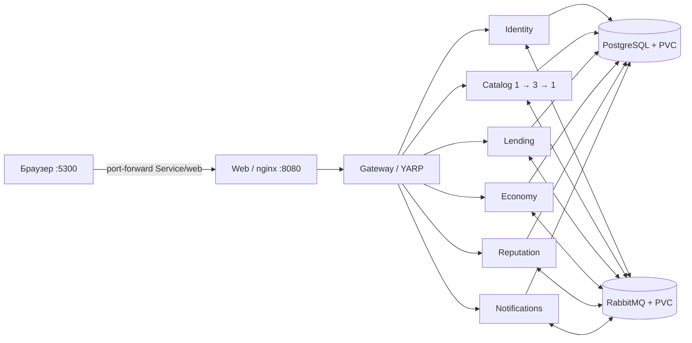
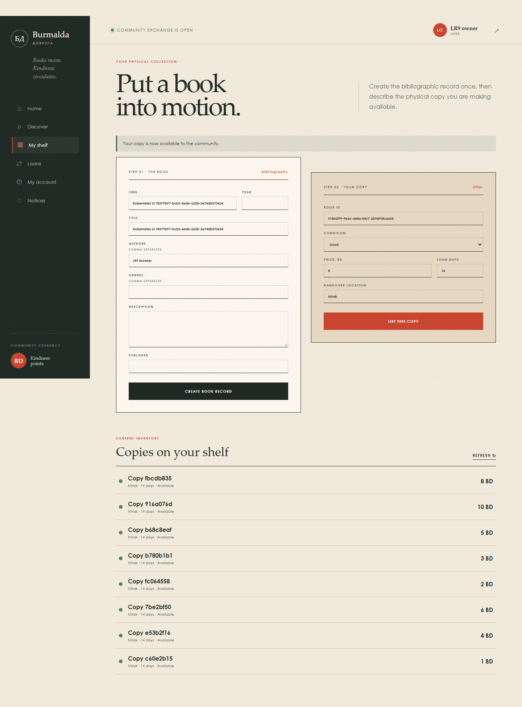
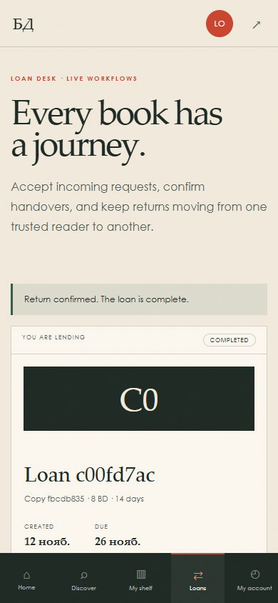

# ЛР №9. Burmalda в Kubernetes Docker Desktop

## Среда и состав

Основная среда содержит Web, Gateway, Identity, Catalog, Lending, Economy, Reputation,
Notifications, PostgreSQL и RabbitMQ. Catalog — предметный сервис для масштабирования.
RabbitMQ передаёт события регистрации, резервирования, выдачи и возврата. Его удаление
нарушило бы бизнес-процесс. PostgreSQL хранит шесть независимых бизнес-БД.

Concurrency/Replication Lab, Library Game, C#-брокеры и подписчики, Raft, PostgreSQL
standby, Jaeger и Collector сохранены в исходниках и `docker-compose.legacy.yml`.
В основной среде их нет. `Features:LearningLabs=false` одновременно скрывает ссылки,
не создаёт компоненты лабораторных страниц (включая их таймеры) и убирает маршруты
Gateway. `Telemetry:Enabled=false` отключает OTLP-экспорт. Архивный Compose включает
обе настройки; старые инструменты явно выбирают архивную конфигурацию.



В кластере используются ClusterIP Service и Kubernetes DNS. Nginx получает конфигурацию
из `web-nginx`: resolver `kube-dns.kube-system.svc.cluster.local`, Gateway —
`gateway.burmalda.svc.cluster.local:8080`. Docker resolver `127.0.0.11` остаётся только
в конфигурации Compose. Браузер обращается к одному origin и не знает адреса API Pod.

Docker Desktop настроен на **один узел, kubeadm**, контекст `docker-desktop`.
Этот provisioner поддерживает один узел; версию выбирает Docker Desktop.
[Документация Docker](https://docs.docker.com/desktop/use-desktop/kubernetes/).

## Запуск

Команды выполняются из корня `burmalda` в PowerShell 7.4+. Для сборки нужны Docker
Desktop в режиме Linux containers и доступ к NuGet/реестрам. .NET SDK и Node нужны
на хосте только для тестов. Kubernetes включается через Docker Desktop → Kubernetes →
Create cluster → kubeadm. Проверка:

```powershell
kubectl --context docker-desktop --namespace burmalda get nodes
./tools/Kubernetes.ps1 Prepare
./tools/Kubernetes.ps1 Build
./tools/Kubernetes.ps1 Start
./tools/Kubernetes.ps1 Status
./tools/Kubernetes.ps1 Access
```

Открыть `http://localhost:5300`. Последняя команда удерживает терминал. Её точный эквивалент:

```powershell
kubectl --context docker-desktop --namespace burmalda port-forward service/web 5300:8080 --address 127.0.0.1
```

Для фонового доступа: `./tools/Kubernetes.ps1 Access -Background`. PID и журналы находятся
в `.artifacts/k8s/access.*`. Скрипт остановки проверяет командную строку процесса, чтобы
не завершить чужой процесс при повторном использовании PID.

`Prepare` создаёт namespace и случайные пароли/JWT-ключ, сохраняет локальный Secret
в `.artifacts/k8s/secret.json` и применяет его. Повторный запуск сохраняет существующий
Secret. Каталог `.artifacts` исключён из Git. В YAML находятся только ссылки
`secretKeyRef`. Администратор — `admin@burmalda.local`; его пароль берётся локально
из `stringData.ADMIN_PASSWORD`, без копирования в отчёт. Можно зарегистрировать
обычных пользователей через клиент.

`Build` использует Dockerfile ЛР8, создаёт уникальный тег `lr9-YYYYMMDDHHMMSS`, а также
удобный алиас `lr9`. Реальные теги и ID записаны в `.artifacts/k8s/images.json`.
`Start` проверяет локальные образы, останавливает основной Compose, применяет YAML и
ожидает готовности StatefulSet и Deployment. Манифест с фактическим тегом генерируется
в `.artifacts/k8s`. `imagePullPolicy: IfNotPresent` позволяет узлу использовать локальные
образы Docker Desktop. Успешный запуск Pod дополнительно подтверждает их доступность
узлу; одного `docker image ls` для этого недостаточно.

Обычная остановка сохраняет данные:

```powershell
./tools/Kubernetes.ps1 Stop
# Deployment и StatefulSet масштабируются до нуля. Namespace, PVC и Secret остаются.
./tools/Kubernetes.ps1 Start
```

Не удалять namespace/PVC и не пересоздавать Secret при сохранённых БД: замена пароля
в Secret сама по себе не меняет пароль роли PostgreSQL.

### Минимальный Compose и архив

```powershell
# Kubernetes сначала остановить, освободив ресурсы и port-forward.
./tools/Kubernetes.ps1 Stop
docker compose up -d --build --wait
docker compose ps
# http://localhost:5300
docker compose stop

# Старые лабораторные — отдельный проект burmalda, с прежними томами:
docker compose -f docker-compose.legacy.yml --profile pubsub up -d --build
docker compose -f docker-compose.legacy.yml --profile pubsub down
```

Основной Compose — проект `burmalda-core`, тома `burmalda-core_core-postgres-data` и
`burmalda-core_core-rabbitmq-data`. Kubernetes создаёт собственные PVC. Старые контейнеры
проекта удалены без `-v`; сохранённые тома перечислены в
`lab-results/kubernetes-verification/preserved-legacy-volumes.txt`. Старые данные
в новые среды не переносились. Одновременно запускать архив и core на одних host-портах
не нужно. Чужие проекты и образы не участвуют в этих командах.

## Манифесты, ресурсы и probes

Cluster — вся среда Kubernetes с управляющими компонентами и узлом. Node — машина
для размещения нагрузки, здесь виртуальный узел Docker Desktop. Pod — единица запуска
контейнеров; в этой работе каждый Pod содержит один контейнер. Три Pod Catalog на одном
Node увеличивают число экземпляров приложения, но число узлов остаётся равным одному.
В YAML `apiVersion` выбирает API ресурса, `kind` — его тип, `metadata` — имя/namespace/метки,
`spec` задаёт желаемое состояние. Label `app: catalog` совпадает с selector Service.

| Файл | Содержание |
|---|---|
| `k8s/namespace.yaml` | Namespace `burmalda` |
| `k8s/configmap.yaml` | Общая конфигурация, `APP_MODE=kubernetes` |
| `k8s/deployment.yaml` | Восемь Deployment, по одному экземпляру |
| `k8s/service.yaml` | Десять ClusterIP Service |
| `k8s/statefulsets.yaml` | Одиночные PostgreSQL/RabbitMQ, PVC 2/1 GiB |
| `k8s/web-config.yaml` | Nginx с Kubernetes DNS и понятной ошибкой 503 |

| Компонент | CPU request / limit | Memory request / limit |
|---|---|---|
| Каждый C# API и Gateway | 100m / 1 | 192Mi / 512Mi |
| PostgreSQL | 250m / 1 | 256Mi / 1Gi |
| RabbitMQ | 100m / 1 | 256Mi / 768Mi |
| Web | 25m / 250m | 32Mi / 128Mi |

`startupProbe` даёт приложению время на создание схемы; до её успеха остальные probes
не мешают запуску. `/health/live` проверяет работающий HTTP-процесс без обращений к
внешним зависимостям. `/health/ready` бизнес-API проверяет свою БД и RabbitMQ.
Gateway и Web проверяют собственную готовность, поэтому отказ Catalog не убирает
сразу весь клиент из доступа. При недоступности backend nginx возвращает JSON 503
с читаемым сообщением. Для PostgreSQL используется TCP `pg_isready -h 127.0.0.1`,
который не принимает временный Unix-socket сервер инициализации за готовую БД.

Requests участвуют в размещении Pod; limits ограничивают потребление. Масштабирование
Catalog не масштабирует PostgreSQL/RabbitMQ и не делает один компьютер отказоустойчивым.

## Почему три Catalog безопасны

1. **Схема.** `EnsureDatabaseAsync` удерживает session advisory lock PostgreSQL на
   одном открытом соединении до завершения bootstrap. Одновременные Pod не создают
   одни и те же таблицы. Перехватчик подключения сохраняет уже открытое соединение,
   включая удерживаемую блокировку.
2. **Outbox.** Publisher начинает транзакцию и берёт advisory transaction lock своей
   БД до выбора пакета. Другие Pod не выбирают тот же пакет одновременно. После
   publisher confirmation сохраняется `PublishedAt`, затем выполняется commit.
   Если процесс умер между публикацией и commit, повторная доставка допустима.
3. **Inbox.** Проверка ID, обработчик и запись inbox выполняются одной транзакцией
   под блокировкой `queue + messageId`. ACK RabbitMQ отправляется после commit.
   Повторное сообщение не повторяет предметную операцию; сбой до commit допускает retry.
4. **Доступность книги.** HTTP-команды и обработчики событий берут одну блокировку по
   `bookId`. Изменение экземпляра сначала сохраняется в текущей транзакции, затем
   пересчитывается проекция, затем всё фиксируется. Параллельные операции не теряют
   обновления остатков. Создание одной ISBN также сериализовано.

Это модель доставки **at least once**, без обещания exactly once. Блокировки PostgreSQL
работают между процессами/Pod, в отличие от локального `lock` или `SemaphoreSlim`.
Интеграционные тесты используют настоящие PostgreSQL/RabbitMQ и отдельные тестовые БД.

Защищённый `GET /api/catalog/runtime` возвращает только `mode` и `instance`.
`APP_MODE` читается из ConfigMap, `HOSTNAME` — из имени Pod; оба значения пишутся при
старте. JWT и параметры подключения endpoint не раскрывает.

## Повторение экспериментов

Автоматическая проверка сначала выполняется в Compose:

```powershell
docker compose up -d --wait
$env:BURMALDA_EXPECTED_MODE='compose'
$env:BURMALDA_RESULT_DIR='lab-results/core-verification'
node tools/verify-core.cjs
Remove-Item Env:BURMALDA_EXPECTED_MODE,Env:BURMALDA_RESULT_DIR
```

После запуска Kubernetes и port-forward:

```powershell
./tools/Verify-Kubernetes.ps1
# С проверкой клиента в установленном Edge и локальным Playwright:
npm install --prefix .artifacts/browser playwright@1.58.2 --no-audit --no-fund
./tools/Verify-Kubernetes.ps1 -Browser
```

Скрипт регистрирует новые учебные аккаунты, создаёт книгу/экземпляр, проходит Saga,
принятие владельцем, передачу, возврат и проекции событий. Проверяет 400, 401, 403,
404, отключённые маршруты. При трёх Catalog одновременно запрашивает одну копию
двумя заёмщиками: только одна Saga должна завершиться выдачей; после отмены победителя
доступность снова равна единице. Шесть параллельных HTTP-команд создания копий одной
книги дополнительно проверяют количество и минимальную цену в проекции.
Браузер проверяет вход, создание книги/копии, заявку, принятие, передачу и возврат,
скрытую навигацию, прямые URL лабораторных, отсутствие фоновых запросов и переполнения
на 1440px/390px. Полный жизненный цикл также проверяется HTTP через тот же Web Service.

Сценарии вручную (все команды явно выбирают контекст и namespace):

```powershell
kubectl --context docker-desktop --namespace burmalda scale deployment/catalog --replicas=3
kubectl --context docker-desktop --namespace burmalda rollout status deployment/catalog
kubectl --context docker-desktop --namespace burmalda get pods -l app=catalog -o wide
kubectl --context docker-desktop --namespace burmalda get endpointslices -l kubernetes.io/service-name=catalog -o yaml
kubectl --context docker-desktop --namespace burmalda get pods -l app=catalog -o custom-columns=NAME:.metadata.name,UID:.metadata.uid,READY:.status.containerStatuses[0].ready
# Подставить имя одного Catalog Pod:
kubectl --context docker-desktop --namespace burmalda delete pod <catalog-pod>
kubectl --context docker-desktop --namespace burmalda get pods -l app=catalog -w
```

Для ConfigMap изменить `APP_MODE` в `k8s/configmap.yaml`, применить и сначала запросить
runtime без restart. Затем:

```powershell
kubectl --context docker-desktop --namespace burmalda apply -f k8s/configmap.yaml
kubectl --context docker-desktop --namespace burmalda rollout restart deployment/catalog
kubectl --context docker-desktop --namespace burmalda rollout status deployment/catalog
```

Переменные окружения существующего процесса автоматически не обновляются. Для нового
значения нужен новый Pod. [Документация ConfigMap](https://kubernetes.io/docs/tasks/configure-pod-container/configure-pod-configmap/).

Ошибочный образ и восстановление (правильный тег взять из `.artifacts/k8s/images.json`):

```powershell
kubectl --context docker-desktop --namespace burmalda set image deployment/catalog catalog=burmalda-catalog:lr9-missing
kubectl --context docker-desktop --namespace burmalda get pods -l app=catalog
kubectl --context docker-desktop --namespace burmalda describe pod <error-pod>
kubectl --context docker-desktop --namespace burmalda get events --sort-by=.metadata.creationTimestamp
kubectl --context docker-desktop --namespace burmalda set image deployment/catalog catalog=burmalda-catalog:<correct-lr9-tag>
kubectl --context docker-desktop --namespace burmalda rollout status deployment/catalog
kubectl --context docker-desktop --namespace burmalda scale deployment/catalog --replicas=1
```

При `maxUnavailable=0` неудачный rollout оставляет старые Ready Pod доступными и
создаёт дополнительный ошибочный Pod. Это ожидаемое поведение, а не отсутствие ошибки.
Port-forward Web выбирает конкретный Web Pod; он не доказывает балансировку Catalog
и может потребовать повторного запуска при удалении выбранного Web Pod.
[Документация port-forward](https://kubernetes.io/docs/reference/kubectl/generated/kubectl_port-forward/).

## Тесты и доказательства

```powershell
dotnet build Burmalda.slnx -m:1
dotnet test tests/Burmalda.Domain.Tests/Burmalda.Domain.Tests.csproj
./tools/Test-CatalogReplicas.ps1
```

`Test-CatalogReplicas.ps1` запускает core PostgreSQL/RabbitMQ. После перехода к
Kubernetes сначала остановить его, чтобы не держать две полные среды. Интеграционные
тесты без переменных подключения помечаются skipped; скрипт задаёт их и требует
настоящего успешного выполнения. TRX находятся в `.artifacts/lr9-tests`.

Публичные доказательства — `lab-results/core-verification` и
`lab-results/kubernetes-verification`: JSON проверок, состояния Pod/EndpointSlice/PVC,
`describe` ошибочного Pod, события и снимки браузера. Сессионный JWT хранится только
в игнорируемом `.artifacts/k8s/check-session.json`. Secret и полные дампы env/Compose
config в доказательства не включаются. Фактические результаты приведены ниже.

## Фактические результаты 12.11.2026

Кластер: Docker Desktop 4.48.0, Docker Engine 28.5.1, Kubernetes **v1.34.1**,
один Ready узел `docker-desktop`. Основной прогон: 2026-11-12T16:54:39.9698928+00:00 —
2026-11-12T16:57:43.5264077+00:00 (UTC); все **7/7** групп экспериментов успешны.
Дополнительная проверка параллельных HTTP-команд и браузера при трёх Catalog:
2026-11-12T16:58:31.225Z — 2026-11-12T16:59:10.980Z, **8/8** проверок успешны.

| Эксперимент | Фактический результат | Доказательство |
|---|---|---|
| Минимальный Compose | 10 healthy контейнеров; полный цикл и конкуренция успешны, `mode=compose` | [API-проверка](../lab-results/core-verification/integration.json) |
| Начальное развёртывание | 10 Ready Pod, только бизнес-компоненты; `mode=kubernetes` | [Начальное состояние](../lab-results/kubernetes-verification/initial.json) |
| Catalog 1 → 3 | 3 Ready Pod, 3 Ready адреса в EndpointSlice | [Три экземпляра](../lab-results/kubernetes-verification/scaled-three.json) |
| Две заявки на одну копию | Одна Saga Completed (`state=2`), одна Failed (`state=4`); после отмены доступность 1 | [Конкуренция](../lab-results/kubernetes-verification/three-replica-operations/integration.json) |
| Параллельные HTTP-команды | 6 созданных копий, проекция availableCopies=6, minimumPrice=1 | [Дополнительный прогон](../lab-results/kubernetes-verification/parallel-http-browser/integration.json) |
| Удаление Catalog Pod | Удалённый UID отсутствует; восстановлены 3 Ready Pod, прежние книга/копия читаются | [Замена Pod](../lab-results/kubernetes-verification/pod-recovered.json) |
| ConfigMap без рестарта | Возвращается прежнее `kubernetes` | [До рестарта](../lab-results/kubernetes-verification/configmap-before-restart/integration.json) |
| ConfigMap после рестарта | Возвращается `kubernetes-configmap-demo` | [После рестарта](../lab-results/kubernetes-verification/configmap-after-restart/integration.json) |
| Отсутствующий тег | Зафиксирован `ErrImagePull`; сохранены describe, события и Pod state | [Describe](../lab-results/kubernetes-verification/bad-image-describe.txt), [события](../lab-results/kubernetes-verification/bad-image-events.json) |
| Возврат правильного образа | Rollout завершён; контрольный запрос успешен | [Контроль](../lab-results/kubernetes-verification/image-restored-operations/integration.json) |
| PostgreSQL недоступен | Клиенту JSON 503; live=200, ready=503 | [Ошибка зависимости](../lab-results/kubernetes-verification/dependency-outage/integration.json) |
| PostgreSQL пересоздан | Новый UID, PVC прежний; сохранённые книга/копия доступны | [Данные после пересоздания](../lab-results/kubernetes-verification/postgres-recreated-operations/integration.json) |
| Браузер Edge | Вход, книга, копия, заявка, принятие, передача и возврат пройдены; JS ошибок 0, demo-запросов 0; 1440×1000 и 390×844 | [Браузерный прогон](../lab-results/kubernetes-verification/parallel-http-browser/integration.json) |
| Итог 3 → 1 | 10 Ready Pod всего, Catalog 1, EndpointSlice Catalog 1; APP_MODE восстановлен | [Итоговое состояние](../lab-results/kubernetes-verification/final.json), [статус](../lab-results/kubernetes-verification/final-status.txt) |
| Обычные Stop → Start | После Stop Pod 0, UID обоих PVC прежние; после Start 10 Ready Pod и прежняя книга/копия доступны | [PVC](../lab-results/kubernetes-verification/stop-preserves-pvc.json), [данные](../lab-results/kubernetes-verification/stop-start-persistence/integration.json) |

Удалённый Catalog: `catalog-76c66c64db-4fgs7`, UID `0fe4f4d5-4114-4af1-9d67-59c48db386b8`.
Его замена: `catalog-76c66c64db-h57wb`, UID `71c7d9d3-bee6-4617-abb2-ba2dbff19ff1`.
PostgreSQL UID: `d7e058f7-f042-449f-8b7f-2c27cb8e5970` → `837ca970-5d02-4826-825c-b70cf926c57a`.
Эти значения относятся к зафиксированному прогону; при повторении UID будут другими.

Инициализированы только `identity_db`, `catalog_db`, `lending_db`, `economy_db`,
`reputation_db`, `notification_db` (кроме служебных БД PostgreSQL):
[фактический SQL-вывод](../lab-results/kubernetes-verification/business-databases.txt).
Теги образов и фактические imageID работающих Pod:
[images.json](../lab-results/kubernetes-verification/images.json).

| Проверка исходников | Результат |
|---|---|
| Сборка всего решения | Успешно, предупреждений 0, ошибок 0 |
| Существующие и дополненные unit-тесты | **60 passed, 0 failed, 0 skipped** |
| Интеграционные тесты PostgreSQL/RabbitMQ | **4 passed, 0 failed, 0 skipped** |
| Состав интеграционных тестов | Три одновременных bootstrap; конкурентная redelivery/inbox; две резервации и возврат проекции; три outbox publisher / 25 уникальных сообщений |
| HTTP ошибки | 400 невалидные данные, 401 без JWT, 403 без роли, 404 неизвестная книга/маршрут, 503 недоступная БД/backend |
| Секреты в доказательствах | Значения сгенерированного Secret не обнаружены; локальные Secret/JWT-файлы исключены Git |

Подробные имена и результаты тестов — [tests.json](../lab-results/kubernetes-verification/tests.json).
Проверка исходников App/NavMenu через Impeccable не сообщила замечаний; внешний вид
осмотрен на desktop/mobile. Сохранён прежний стиль, удалена только учебная навигация.
Архивная полная среда после изменений не поднималась: проверены её Compose-конфигурация,
сборка сохранённых проектов и сохранность старых томов; исторические результаты ЛР2–ЛР8
не выдаются за новый прогон.





## Диагностика и сравнение

| Ситуация | Что проверить | Действие |
|---|---|---|
| Контекст/кластер недоступен | `kubectl --context docker-desktop --namespace burmalda get nodes` | Запустить Desktop, включить kubeadm и дождаться Ready |
| Pending | `describe pod`, события, requests, PVC | Освободить ресурсы; проверить storageclass/PVC |
| ErrImagePull / ImagePullBackOff | Имя/тег, события pull, локальный ledger | Вернуть существующий тег, дождаться rollout |
| CrashLoopBackOff | `logs <pod> --previous`, текущие logs | Исправить ошибку приложения/конфигурации, пересобрать и перезапустить |
| Pod Running, но не Ready | `/health/ready`, PostgreSQL и RabbitMQ | Восстановить зависимость; не заменять readiness пустой проверкой |
| ConfigMap изменена, runtime прежний | Возраст/UID Pod | Явный rollout restart |
| Service не отвечает | selector Service, Ready EndpointSlice, порты, DNS | Исправить несовпадение label/port или readiness |
| Клиент получает 503 | Gateway/backend Ready, журналы nginx/YARP | Восстановить backend; в тесте это ожидаемая читаемая ошибка |
| Пропали данные после рестарта | PVC Bound, mountPath/PGDATA | Подключить прежний PVC; не удалять его при обычной остановке |
| Port-forward завершился | Процесс доступа и выбранный Web Pod | Повторить `Kubernetes.ps1 Access` |
| Docker перестал отвечать, no space left | Свободное место C:, журнал Desktop | Освободить место на диске виртуальной машины; не удалять учебные тома |

| Свойство | Docker Compose | Kubernetes в этой работе |
|---|---|---|
| Единица запуска | Контейнер сервиса | Pod под управлением Deployment/StatefulSet |
| Адресация | Docker DNS и publish портов | ClusterIP Service, DNS, EndpointSlice |
| Масштабирование | `--scale`, нужно учитывать host-порты | `replicas`, Service выбирает Ready Pod |
| Восстановление | restart policy контейнера | Контроллер восстанавливает желаемое число Pod с новым UID |
| Обновление | Пересоздание контейнера | RollingUpdate и управляемый rollout |
| Настройки/секреты | env/.env локальной учебной среды | ConfigMap / локально сгенерированный Secret |
| Данные | Новые core named volumes | StatefulSet + PVC; остановка не удаляет PVC |
| Отказ машины | Приложение недоступно | Приложение также недоступно: узел один |

На защите: Deployment задаёт желаемое число экземпляров, ReplicaSet поддерживает его,
Service даёт постоянную точку доступа к Ready Pod. Удаление Pod проверяет восстановление
контроллером, а не отказоустойчивость хоста. StatefulSet даёт устойчивую идентичность и
подключение PVC, но одиночные PostgreSQL и RabbitMQ остаются единственными экземплярами.
Сохранение книги после пересоздания PostgreSQL доказывает работу PVC. Уникальный UID
нового Catalog доказывает замену Pod. Три Ready адреса в EndpointSlice подтверждают
включение трёх экземпляров в Service; запрос runtime показывает обслуживший экземпляр.
